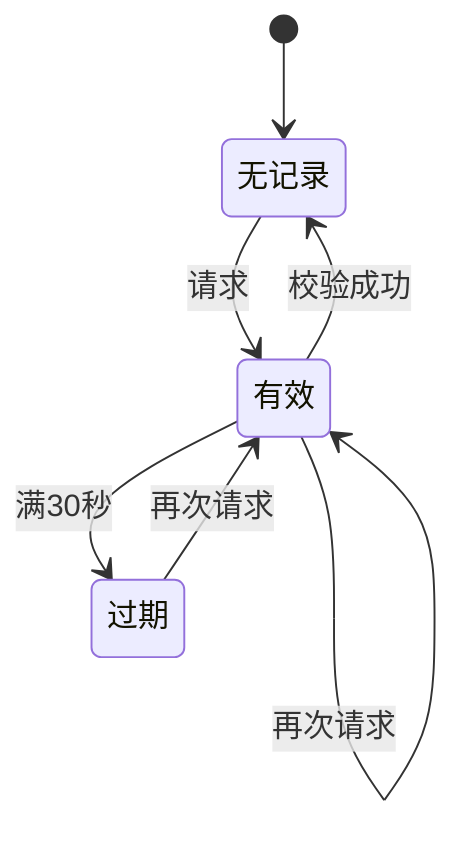

## Q
密码重置服务（PasswordResetService）共享一个存储：用户表加每个用户的重置记录，多个服务实例同时在线。服务自己要记住什么、库里要存什么？哪条不变量一旦破了，后果最严重？

## A
**状态在共享库里；服务只留配置快照和本实例的码账本**

- **每用户至多一条记录**：`save_reset_code` 覆盖旧记录，所以再次请求就换码并重开 30 秒
- **记录时间统一成 UTC 时刻**：写入前转换，读出时无时区的旧值也当 UTC，后面不再想时区
- **过期是算出来的**：库里不存"已过期"，过期记录留着，直到被新请求替换
- **码账本只增不减**：每个实例记下生成过的所有码，这是"不重复"的代价
- **读出的记录只读**：`get_reset_code` 返回库里那条本体，改它等于绕过存储边界
- **最要紧的不变量**：一个码最多成功一次；"存密码"先于"清记录"，且没有第二处能清或改



```python
class UniqueCodes:
    def __init__(self) -> None:
        self._seen: set[str] = set()

    def issue(self, generate, stored):
        for _ in range(MAX_ATTEMPTS):
            code = generate()
            taken = code in self._seen or code == stored
            self._seen.add(code)
            if not taken:
                return code
        raise RuntimeError("code generator keeps returning codes that are already taken")
```

<details class="pt"><summary>延伸</summary>账本会随请求数无限增长；生产里用足够长的随机码加库里的唯一约束，就可以不留这张账本。</details>

**知识点：** 不变量与封装（Invariants）、防御性拷贝（Defensive Copying）、非法转移与幂等（Illegal Transitions）
