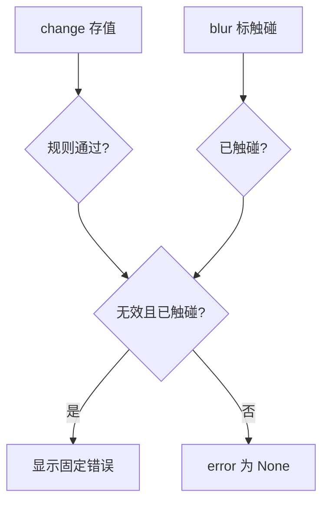

## Q
在支付表单校验组件里，`PaymentForm(currentYear)` 用 `change`、`blur`、`reset`、`snapshot` 管理卡号、姓名、月份、年份、CVV 五个字段。开工前你会先定下哪几条规则？

## A
**改值不碰触碰，碰过才报错，全有效且全碰过才能提交**

- **改值不碰触碰**：`change` 原样存字符串，不裁剪、不补零；只有 `blur` 才标触碰，之后一直保持
- **错误要两个条件**：`error` 仅在「已触碰且无效」时是固定文字，其余一律 `None`
- **提交要两个条件**：`canSubmit` = 五个字段都有效且都碰过；改短 CVV 立刻变假
- **数字只认 `0–9`**：`isdigit()` 会放过 `٣٣٣`、`２０２８`、`²`，要先 `isascii()`；前导零保留
- **年份窗口含两端**：`currentYear` 到 `currentYear+3`，月份只看 `01–12`，两者互相独立
- **重置保留年份**：清空值和触碰标记，规则不动；快照每次都是新对象



```python
def snapshot(self):
    fields = {}
    for name in FIELD_NAMES:
        entry, rule = self._entries[name], self._rules[name]
        valid = rule.accepts(entry.value)
        shown = entry.touched and not valid
        fields[name] = FieldState(entry.value, entry.touched, valid,
                                  rule.message if shown else None)
    ok = all(s.valid and s.touched for s in fields.values())
    return PaymentSnapshot(fields, ok)
```

<details class="pt"><summary>延伸</summary>规则是「字段名到 Rule」的一张表，不为五个字段各建一个类；月份和年份写成合法字符串的集合，不调用 `int()`，也就没有正负号和空白的歧义。</details>

**知识点：** 边界校验（Validate at the Boundary）、字符串与字节（Strings & Bytes）、守卫、动作和进出钩子（Guards, Actions, Hooks）
