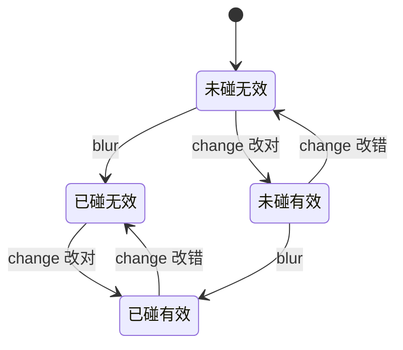

## Q
在支付表单校验组件里，用户在卡号框敲了五位数就跳去填姓名，几秒后回来补全成十六位。这段时间里这个字段的 `valid`、`touched`、`error` 各怎么变？你的实现把这三样分别放在哪里？

## A
**`valid` 跟着值现算，`touched` 只被失焦改变，`error` 是两者的组合，不单独存**

- **敲五位时**：`valid=False`，`touched=False`，`error=None`——还没离开，不该红
- **跳走那一刻**：`blur` 把 `touched` 变真，快照里 `error` 立刻是 `Invalid Card Number`
- **回来补全**：`change` 不碰 `touched`，`valid` 变真，`error` 马上回到 `None`
- **再删掉一位**：`touched` 仍是真，所以红字立刻又出现
- **存放**：条目里只有 `value`、`touched`；`valid` 来自规则，`error` 来自 `touched and not valid`
- **这样拆的好处**：没有第二份状态可以失同步，新增 `touch_all` 只改一个标记



```python
valid = rule.accepts(entry.value)           # 由值算出
shown = entry.touched and not valid         # 由事件加值组合
error = rule.message if shown else None     # 用户看到的红字
```

<details class="pt"><summary>延伸</summary>表单字段变成五十个、校验要请求服务器时，才把 `valid` 缓存起来，并加一个版本号防止过期响应覆盖新值。</details>

**知识点：** 守卫、动作和进出钩子（Guards, Actions, Hooks）、边界校验（Validate at the Boundary）
