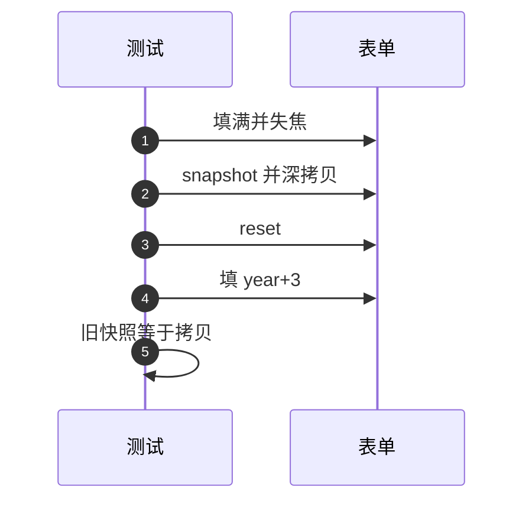

## Q
在支付表单校验组件里，测试环境把注入的年份从 2026 改成 2040 之后，原来写死 2026 的测试全挂了。你要新写哪些检查，才能不依赖任何默认年份地证明「重置」和「快照互不牵连」都对？

## A
**换年份测边界，持旧快照再操作，乱改返回值再查**

- **年份相对化**：用 2000、2040、2096 各建一次表单，检查 `year-1`、`year`、`year+3`、`year+4`
- **重置保留年份**：填满、`reset`、再填 `year+3` 仍有效，`year+4` 无效；清空后每个字段回到初始
- **旧快照不变**：拿到快照并深拷贝，做 `change`、`blur`、`reset`，旧快照与拷贝相等
- **返回值被破坏**：对快照赋值、清空 `fields`、新增键，再取新快照，与表单真实状态相同
- **两个表单**：对 A 做一串操作，B 的快照不变；A 与 B 用不同年份时窗口各算各的
- **随机对拍**：固定种子的随机字符串与独立的 `[0-9]` 正则参照实现比较



```python
def test_reset_keeps_year():
    form = PaymentForm(2040)
    form.change("year", "2043")
    form.reset()
    form.change("year", "2043")
    year = form.snapshot().fields["year"]
    assert year.valid
    form.change("year", "2044")
    assert not form.snapshot().fields["year"].valid
```

<details class="pt"><summary>延伸</summary>快照做成冻结的数据类加元组，隔离由类型保证而不是靠测试去证明；代价是调用方想改也改不了，需要显式 `replace`。</details>

**知识点：** 防御性拷贝（Defensive Copying）、为测试而设计、边界校验（Validate at the Boundary）
