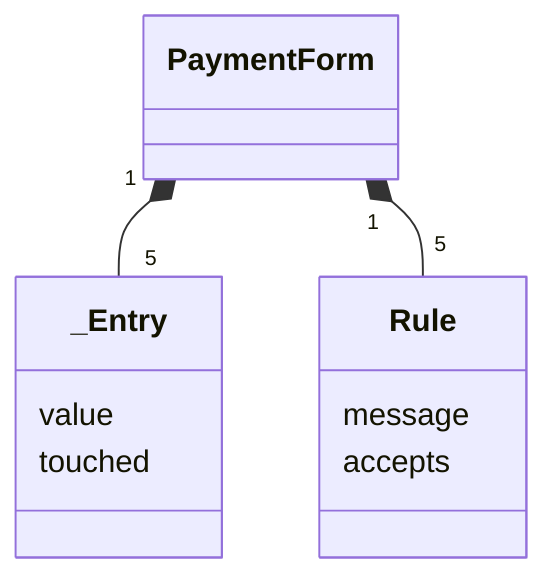

## Q
在支付表单校验组件里，每个字段的快照要给出 `value`、`touched`、`valid`、`error`，再加整张表的 `canSubmit`。内部到底要存哪些状态？哪条不变量最要紧？

## A
**只存字符串和触碰，其余都现算**

- **每字段两个事实**：用户敲进去的字符串、是否失焦过；条目里没有 `valid` 和 `error`
- **不变量**：派生值不单独存，所以永远和值、触碰对得上，新增入口（`touch_all`）也不用同步
- **规则表在构造时定好**：年份窗口随注入的年份算出，`reset` 重建条目、不碰规则
- **快照现建**：每次新字典、新 `FieldState`；字符串不可变可以共享，没有可变对象出去
- **实例各自一份**：条目字典在 `__init__` 里建，不是类属性，两个表单互不影响
- **失败不留痕**：未知字段、非字符串值在改任何东西之前就抛异常



```python
@dataclass(slots=True)
class _Entry:
    value: str = ""
    touched: bool = False

def reset(self) -> None:
    # 换一份新字典：已取走的快照不会被牵连，规则（含年份）原样保留
    self._entries = {n: _Entry() for n in FIELD_NAMES}
```

<details class="pt"><summary>延伸</summary>校验很贵（远程查重）时，只对那一个字段按「字段加值」缓存；缓存失效集中在一个出口，其余字段仍然现算。</details>

**知识点：** 防御性拷贝（Defensive Copying）、守卫、动作和进出钩子（Guards, Actions, Hooks）
