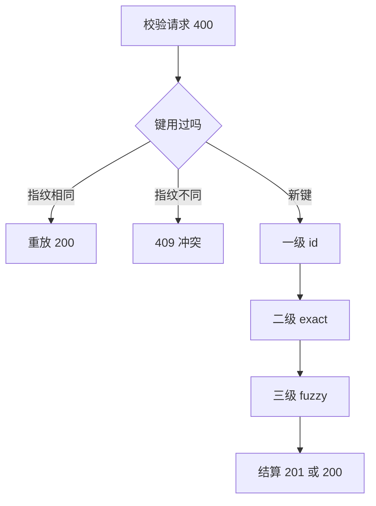

## Q
你要给付款对账服务（payment reconciliation）写 HTTP 背后的服务类：登记发票批次，把银行付款匹配到未付发票，支持带幂等键的重试和全有或全无的付款批次。动手写之前，你会先定下哪几条规则，让隐藏测试没有可钻的空子？

## A
**先校验再查键；id、exact、fuzzy 三级严格优先；同键同请求重放，同键异请求 409**

- **校验顺序**：先校验请求（400）再查键；登记按行序，格式错 400 与批内重复 409 先遇到的赢，全部通过后才查账本里已有的号
- **三级匹配**：备注里的发票号（id）→ 金额相等（exact）→ 容差内（fuzzy，`forgiveness > 0` 才开，闭区间）；只看未付发票
- **平局**：同一级里到期日最早，再金额差最小，再发票号最小
- **备注标记**：`paying for:` 与 `paying off:` 用 `re.IGNORECASE` 找，`İ`、`ı` 也算 i，位置取自原串；发票号取到下一个逗号，保留大小写
- **幂等**：指纹是（付款串去首尾空白，forgiveness）；同键同指纹重放 200 且不改状态，未匹配也缓存；同键不同指纹 409
- **批次与整数**：逐行处理，第一个错误按行序胜出并撤销整批；金额是只含 ASCII 数字的整数分



```python
def match(self, request):
    hit = self._explicit(request.memo)                 # 一级：备注里的发票号
    if hit is not None:
        return hit, Tier.ID
    hit = self._closest(request.amount, 0)             # 二级：金额相等
    if hit is not None:
        return hit, Tier.EXACT
    if request.forgiveness > 0:                        # 三级：闭区间容差
        hit = self._closest(request.amount, request.forgiveness)
        if hit is not None:
            return hit, Tier.FUZZY
    return None
# _closest 里：min(候选, key=(到期日, abs(差), 发票号))
```

<details class="pt"><summary>延伸</summary>把 README 的每个例子先写成断言再交给编程智能体；标记匹配、平局顺序、校验先于查键这三处最容易被它顺手写错。</details>

**知识点：** 边界校验（Validate at the Boundary）、接口的错误契约（Error Contract）、时间与数字（Time & Numbers）
