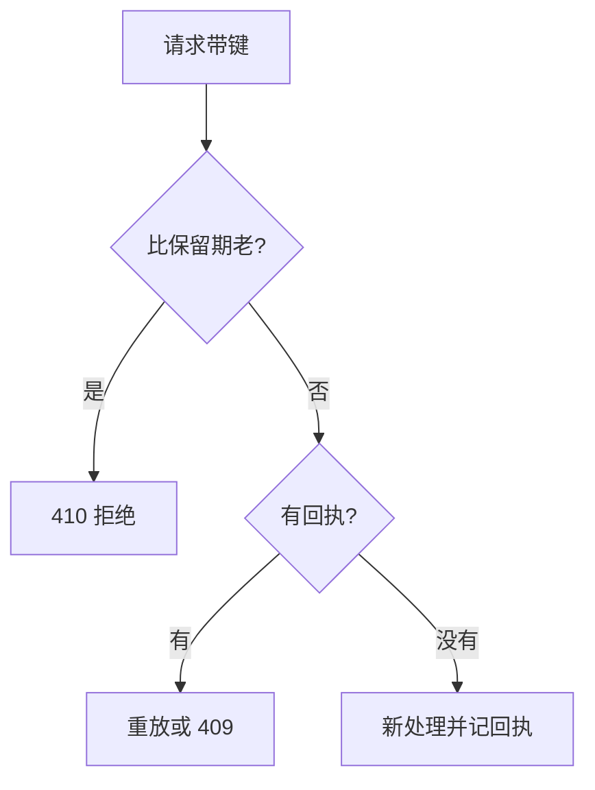

## Q
付款对账服务的幂等回执一直留在内存里，几个月后撑爆了，要定期清掉旧的。但客户端崩溃重启后，可能隔很久才重发同一笔付款。怎样清理，才不会让这次迟到的重试再结算一张发票？

## A
**保留期必须长于客户端最长的重试窗口，并且让过期的键被拒绝，而不是被当成新键**

- **保留期是合同**：写进接口文档（比如 24 小时），要大于客户端重试的总时长
- **键里带时间戳**：`<秒>-<随机串>`；服务端看到比保留期更老的键，直接回 410，不用存任何东西
- **清理只删过期的**：按创建时间分批删，处理中的请求不删，别在持锁时一次删光
- **回执只留需要的**：指纹的摘要加响应体，不存整个请求
- **付款号兜不了底**：同一个付款号可以合法地再次使用，不能拿它去重



```python
def check_fresh(key, now, window=timedelta(hours=24)):
    stamp = int(key.split("-", 1)[0])            # 键 = "<秒>-<随机串>"
    issued = datetime.fromtimestamp(stamp, timezone.utc)
    if now - issued > window:
        # 迟到的重试：拒绝，而不是当新键重新结算
        raise ServiceError(410, "idempotency_key_expired")
```

<details class="pt"><summary>延伸</summary>后台清理和请求路径共用同一把锁时，分批删除并让出锁；多实例时回执表加索引 `created_at`，用一条带上限的 `DELETE` 清理。</details>

**知识点：** 重试与退避（Retry & Backoff）、接口的错误契约（Error Contract）、复合操作（Compound Actions）
