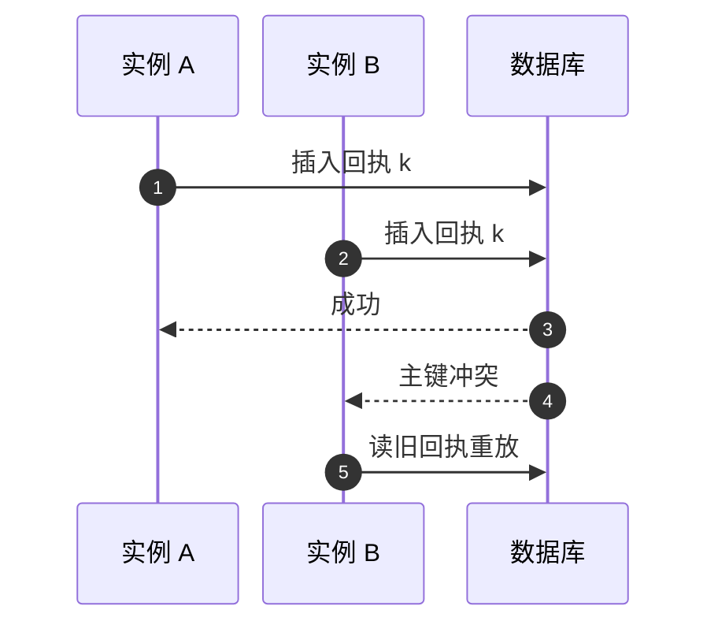

## Q
付款对账服务现在是一个进程里一把锁。流量涨十倍，要放到三台实例后面，由负载均衡随机分发请求。一个付款批次的几次结算和它写下的幂等键，怎样才能仍然全有或全无？同一个键的两个并发请求怎样仍然只结算一次？

## A
**原子性下沉到共享数据库：一个事务、条件更新、键上的主键约束**

- **一个事务**：整批在 `BEGIN IMMEDIATE` 里，出错整体 `ROLLBACK`，结算与回执一起撤销；进程内的锁管不到别的实例
- **条件更新**：`UPDATE … WHERE invoice_id=? AND settled_by IS NULL`，影响 0 行就是被别人抢先，重新匹配
- **键靠主键**：回执表的 `key` 是主键，两个实例同时插入必有一个失败，失败者读出旧回执再重放或 409
- **匹配与结算同一个事务**：否则两个实例各选同一张发票，条件更新只放过一个
- **事务要短**：事务里不调外部服务；冲突重试设上限



```python
def settle(db, invoice_id, payment_id):
    n = db.execute("UPDATE invoices SET settled_by=? "
                   "WHERE invoice_id=? AND settled_by IS NULL",
                   (payment_id, invoice_id)).rowcount
    return n == 1                        # 0 行：别的实例抢先了

def batch(db, rows):
    db.execute("BEGIN IMMEDIATE")        # 整批一个事务
    try:
        for row in rows:
            apply(db, row)               # 查回执、结算、插回执
        db.execute("COMMIT")
    except BaseException:
        db.execute("ROLLBACK")           # 结算与回执一起撤销
        raise
```

<details class="pt"><summary>延伸</summary>要分片时，把同一个键和它能匹配的发票放在同一个分片里（按账户哈希），跨分片的批次才需要两阶段提交，能不做就不做。</details>

**知识点：** 复合操作（Compound Actions）、重试与退避（Retry & Backoff）、内存持久化（In-Memory Persistence）
