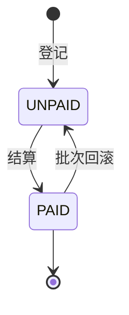

## Q
付款对账服务把发票、幂等回执和批次的撤销记录都放在内存里，多个线程同时调用登记、付款、列表和批次。要存哪些状态？每部分用什么结构？哪条不变量最要紧，什么会打破它？

## A
**一本账、一份回执表、一把锁；一张发票至多被结算一次，批次对外全有或全无**

- **发票**：按（到期日，发票号）有序的列表加发票号字典；状态由 `settled_by` 推出来，不另存一份
- **回执表**：键 → （指纹，状态码，响应体的私有拷贝）；重放给新字典，不给内部对象
- **撤销日志**：只在批次事务里记录每次结算和回执，出错按相反顺序撤销
- **一把锁**：登记、付款、列表、批次都在锁内；批次整段持锁，回滚发生在放锁之前
- **打破不变量**：查键放在锁外（同键结算两次）；只撤结算不撤回执（键记住了没发生的结果）；状态与 `settled_by` 各存一份（两份会不一致）



```python
@contextmanager
def transaction(self):
    self._undo = []                      # 开始记日志
    try:
        yield
    except BaseException:
        for undo in reversed(self._undo):
            undo()                       # 结算、回执按相反顺序撤销
        raise
    finally:
        self._undo = None
```

<details class="pt"><summary>延伸</summary>撤销日志的代价与改动成正比，整本账拷贝的代价与账本大小成正比；账本大了以后前者才站得住。回滚只在锁内发生，所以别的线程永远看不到 PAID 又变回 UNPAID。</details>

**知识点：** 不变量与封装（Invariants）、防御性拷贝（Defensive Copying）、复合操作（Compound Actions）
