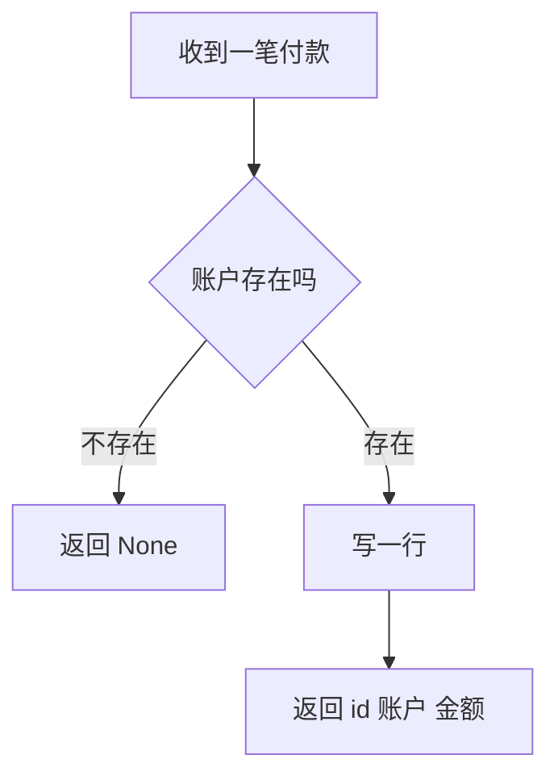

## Q
在付款记录服务（Payments API）里，你要补三个函数：建账户、按 id 查账户与余额、给账户记一笔付款；数据放在 SQLite，HTTP 层已经写好。开工前你会先定下哪几条规则？

## A
**合同写成数字例子：缺失、余额、序列、重开各一条**

- **缺失是正常结果**：查询和记付款遇到不存在的账户都返回 `None`，不抛异常
- **余额是求和**：该账户全部付款金额之和，正负都算；没有付款是 0；不检查透支
- **失败不留痕**：缺失账户的付款不写行，也不消耗付款 id
- **两条序列各自独立**：账户 id 与付款 id 互不影响；金额 0 也是一条记录，也推进序列
- **重开不丢**：账户、付款、余额、两条序列都在；不同的库文件互不共享
- **连接归调用方**：函数不关连接；余额和 id 是 `int`，不是 `float`



```python
PAY = """INSERT INTO payments (account_id, amount)
         SELECT a.id, ? FROM accounts AS a WHERE a.id = ?"""

def create_payment(database, account_id, amount):
    cursor = database.execute(PAY, (amount, account_id))
    if cursor.rowcount == 0:          # 账户不在：一行没写
        return None
    return Payment(cursor.lastrowid, account_id, amount)
```

<details class="pt"><summary>延伸</summary>每条规则配一个数字例子：建账户 → 记 700 → 记 1300 → 查得 2000；对不存在的 77 记付款得 `None`，再对真账户记付款，id 仍是 1。数据库换成 PostgreSQL 时，失败的插入会烧掉序列值，"不消耗 id"这条要靠"不产生待插入行"来保证。</details>

**知识点：** 规格与契约（Specifications）、返回值设计（Return Values）、接口的错误契约（Error Contract）
