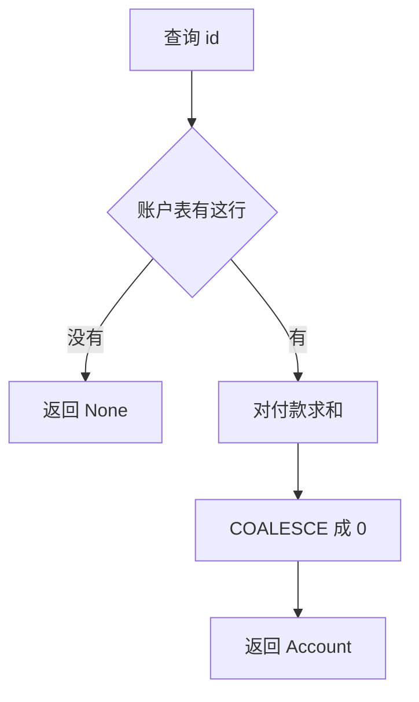

## Q
在付款记录服务（Payments API）里，调用方查一个刚建好、还没有付款的账户，要得到余额 0 的账户；查一个从没建过的 id，要得到 `None`。你的查询怎样把这两种情况分开？写错会得到什么？

## A
**存在性问账户表，余额才问付款表；两件事放进同一条语句：账户表出发加标量子查询**

- **只对付款表求和**：这两种情况都得到 `NULL`，分不开
- **内连接付款表**：没有付款的账户被连接丢掉，被当成不存在
- **从账户表出发**：有行就是存在；子查询对空集给 `NULL`，用 `COALESCE(…, 0)` 换成 0
- **同一条语句**：存在性和余额读自同一个快照，其间插不进别的写入
- **别用 `TOTAL()`**：它返回浮点数，`0.0` 不等于合同要的整数



```python
# 账户 2 存在但没有付款；账户 77 不存在
db.execute("SELECT SUM(amount) FROM payments WHERE account_id=?", (2,)).fetchone()   # (None,)
db.execute("SELECT SUM(amount) FROM payments WHERE account_id=?", (77,)).fetchone()  # (None,)
get_account(db, 2)    # Account(id=2, balance=0)
get_account(db, 77)   # None
```

<details class="pt"><summary>延伸</summary>同一个思路出现在所有"零值还是缺失"的接口里：先用拥有存在性的那张表判断有没有，再去聚合；聚合结果为空不等于对象不存在。</details>

**知识点：** 返回值设计（Return Values）、异常与错误值（Exceptions vs Values）、内存持久化（In-Memory Persistence）
