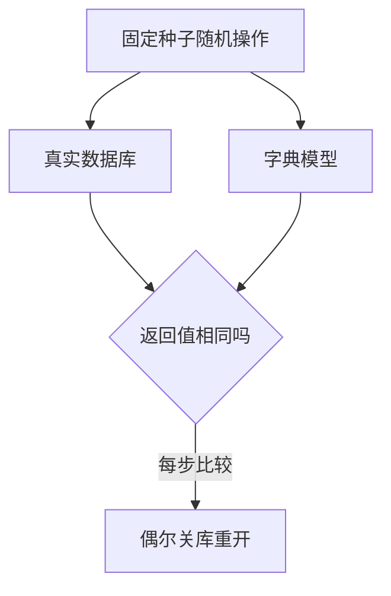

## Q
在付款记录服务（Payments API）里，评审时有人想把余额查询从子查询改成连接，另一个人想把求和挪到 Python 里。你的测试怎样对这些写法都给出可信的判决，并且覆盖关库重开后的数据？

## A
**只经公开函数观察，期望值由笨模型算**

- **手算例子**：小到能心算，建账户、记 700、记 1300、余额 2000
- **和模型对拍**：同一串随机操作同时喂数据库和一个字典，每一步比较返回值，种子固定
- **夹着重开**：序列中随机关库再开，余额与两条序列必须接着走
- **边界**：金额 ±10 亿、余额超过 32 位、id 和余额取到 2^53−1，类型必须是 `int`
- **失败路径**：缺失账户的付款之后，下一笔付款的 id 不跳号
- **不碰实现**：不断言 SQL 文本、语句条数、`sqlite_sequence` 的内容



```python
rng = random.Random(seed)
balances, next_payment = {}, 1
for _ in range(250):
    if rng.random() < 0.2:
        balances[create_account(db).id] = 0
        continue
    target = rng.randint(0, len(balances) + 2)
    amount = rng.randint(-500, 500)
    got = create_payment(db, target, amount)
    if target in balances:
        assert got == Payment(next_payment, target, amount)
        balances[target] += amount
        next_payment += 1
    else:
        assert got is None
```

<details class="pt"><summary>延伸</summary>模型越笨越好：它不该懂 SQL。想再加一层，用另一条查询写法的实现跑同一套测试；只要测试不碰实现细节，换写法不需要改一行测试。</details>

**知识点：** 为测试而设计、验证输出（Verification）、规格与契约（Specifications）
