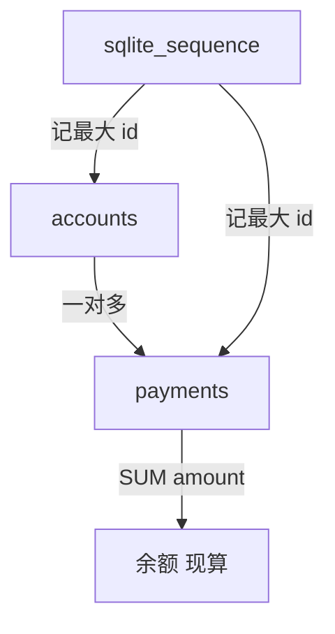

## Q
在付款记录服务（Payments API）里，账户表只有一个 id 列，付款表有 id、账户 id、金额。余额放在哪里、由谁维护？哪几条不变量最要紧，每条靠什么机制守住？

## A
**只存两张表；余额不存，每次从付款现算，所以余额与流水永远不会不一致**

- **余额是派生量**：等于该账户付款金额之和；多存一列就多一份要同步的副本，漏一次写就错
- **存在性只问账户表**：账户行存在才算账户存在；付款表的内容不能当存在性的证据
- **付款指向真账户**：外键连接级打开（`PRAGMA foreign_keys=ON`），写入语句本身也只对存在的账户产出行
- **id 只增不减不复用**：`AUTOINCREMENT` 把最大值记进 `sqlite_sequence`，关库重开后接着走
- **一条语句一个事务**：连接是自动提交模式，三个函数各只发一条会改数据的语句，所以天然原子



```python
BALANCE_OF = """
SELECT a.id,
       (SELECT COALESCE(SUM(p.amount), 0)
        FROM payments AS p WHERE p.account_id = a.id)
FROM accounts AS a WHERE a.id = ?"""

def get_account(database, account_id):
    row = database.execute(BALANCE_OF, (account_id,)).fetchone()
    return None if row is None else Account(row[0], row[1])
```

<details class="pt"><summary>延伸</summary>流水很多时，在 `payments(account_id)` 上建索引，否则每次查余额都扫全表；再大就加一张按账户汇总的表并和付款在同一事务里更新，代价是多了一份要守住的不变量。</details>

**知识点：** 内存持久化（In-Memory Persistence）、不变量与封装（Invariants）、值对象与实体（Value vs Entity）
