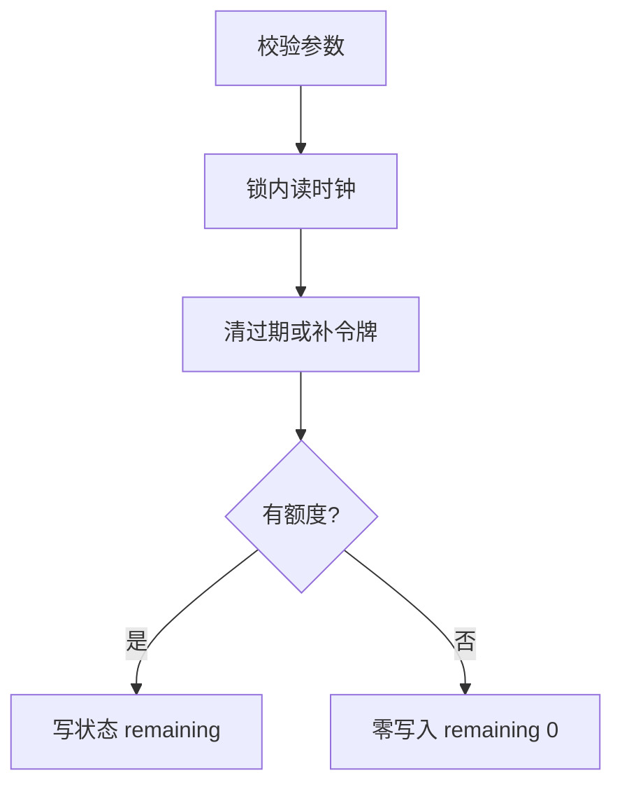

## Q
在 LLM 网关限流器里，网关每个请求前调用 `check(client_id, endpoint, …)`，得到 `(allowed, remaining, reset_after_ms)`；滑动窗口和令牌桶二选一，多个线程同时调用，另有 `stats()`。开工前你会先定下哪几条规则？

## A
**remaining 判后算，被拒零写入，毫秒向 0 截断，按 key 隔离**

- **remaining 判后算**：放行后还能立刻放行几次；被拒恒为 0，不含以后才补回的额度
- **被拒不留痕**：不扣额度、不进放行历史；重试再勤也不推迟恢复
- **毫秒向 0 截断**：结果是 `int`，不四舍五入；内部用整数纳秒
- **按 (client_id, endpoint) 隔离**：换接口、换客户端都是一份全新额度
- **令牌数保留小数**：0.6 个令牌不取整，攒到 1.0 时放行
- **时间由限流器读**：`check` 没有时间参数，所以时钟要能注入，测试里不用 sleep



```python
allowed = len(stamps) < limit            # 已清掉过期的
if allowed:
    stamps.append(now)                   # 只有放行才写
remaining = limit - len(stamps) if allowed else 0
reset_ms = max(0, stamps[0] + window - now) // NS_PER_MS
return Decision(allowed, remaining, reset_ms)
```

<details class="pt"><summary>延伸</summary>令牌桶放行时 `remaining = int(tokens - 1)`、reset 为 0；被拒时 reset 是 `int((1 - tokens) / rate * 1000)`，`refill_rate` 为 0 时直接返回 0，不做除法。</details>

**知识点：** 限流器（Rate Limiter）、边界校验（Validate at the Boundary）、接口的错误契约（Error Contract）
