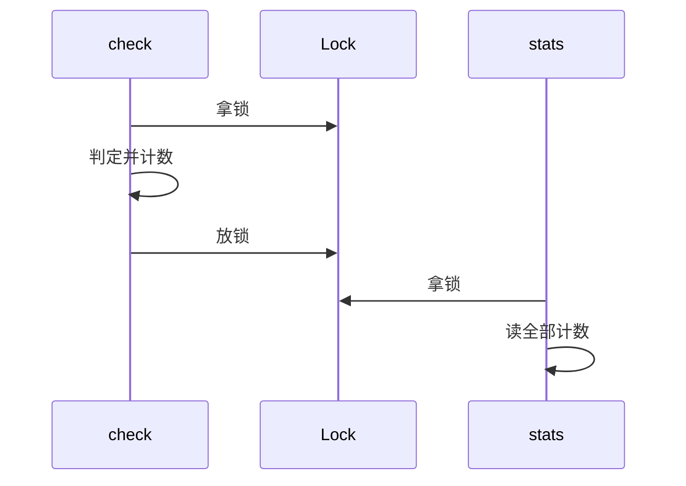

## Q
LLM 网关限流器的项目要你写一段反思：一个线程在做 `check` 时，另一个线程可能正在读 `stats()`。你的实现靠什么保证一次放行与它的计数一起生效、互不打架？流量涨十倍时这个办法贵在哪里，怎么降？如果同一台机器上开四个服务器进程共用同一套限额，又会怎样？

## A
**一把锁罩住读时钟、判定、记账、计数；代价是所有 key 串行，分片可降**

- **机制**：同一把 `Lock` 罩住读时钟、判定、追加、计数，`stats` 也拿它
- **GIL 不够**：先检查后追加、`+= 1` 都是多步，线程会在中间切换
- **不能分两把锁**：判定一把、计数一把，`stats` 会读到已放行但没计数的瞬间
- **代价**：所有 key 排队，流量涨十倍后锁竞争先于计算成为瓶颈
- **降低**：按 key 哈希分片，每片一把锁；`stats` 按固定顺序取全部锁
- **四个进程**：各有各的字典和锁，实际限额最多放大到单进程限额 × 4，要改共享存储



```python
def check(self, client_id, endpoint, *params):
    with self._lock:
        now = self._clock()
        result = self._decide(now, client_id, endpoint, *params)
        if result.allowed:
            self._total_allowed += 1
        else:
            self._total_rejected += 1
        return result

def stats(self):
    with self._lock:
        return {"total_allowed": self._total_allowed,
                "total_rejected": self._total_rejected}
```

<details class="pt"><summary>延伸</summary>临界区只做字典查找和整数运算，先分片再考虑别的；CPython 的 GIL 下纯 Python 代码本就串行，分片减的是锁等待。同机多进程可用共享内存加跨进程锁，扩到多机就要共享存储，见下一张卡。</details>

**知识点：** 复合操作（Compound Actions）、线程安全结构的写法（Thread-Safe Structures）、内存模型与可见性（Memory Model）
