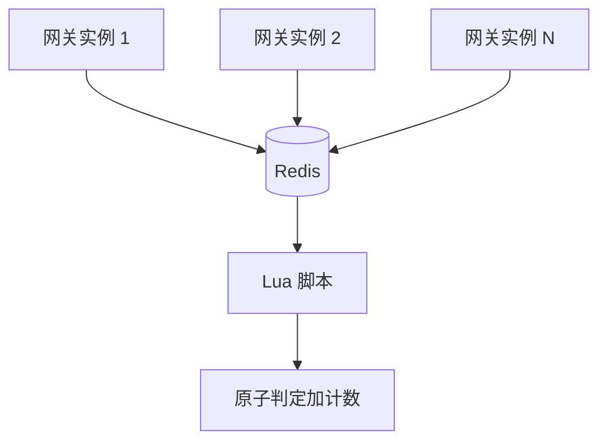

## Q
LLM 网关限流器的项目要你写第二段反思：网关从一台机器扩到二十台、前面加了负载均衡，限流状态不能再放在各自的内存里。设计要怎么改？如果把状态放进 Redis，哪几步必须仍然是原子的，又多出了哪些新问题？

## A
**状态外移到共享存储，读判写在服务端一次执行，时间取存储端**

- **状态外移**：窗口用有序集合存时间戳，令牌桶存（令牌数，时刻）
- **读判写原子**：Redis 用 Lua 脚本（`EVAL`）；Memcached 只能 `cas` 重试，竞争高时重试多
- **时间取存储端**：各实例时钟有漂移，窗口边界会错位
- **TTL 代替回收**：窗口 key 设窗口长度，令牌桶设补满所需时间
- **新问题**：每个请求多一次往返，存储成为故障点，要定 fail open 还是 fail closed
- **折中**：本地预取一批额度、定期对账；统计改写共享计数器



```python
TOKEN_BUCKET = """
local cap, rate = tonumber(ARGV[1]), tonumber(ARGV[2])
local t = redis.call('TIME')
local now = t[1] * 1000 + math.floor(t[2] / 1000)
local st = redis.call('HMGET', KEYS[1], 'tokens', 'ts')
local tokens = tonumber(st[1]) or cap
local ts = tonumber(st[2]) or now
tokens = math.min(cap, tokens + math.max(0, now - ts) / 1000 * rate)
if tokens < 1 then
  local wait = 0
  if rate > 0 then wait = math.floor((1 - tokens) / rate * 1000) end
  return {0, 0, wait}
end
tokens = tokens - 1
redis.call('HSET', KEYS[1], 'tokens', tokens, 'ts', now)
if rate > 0 then redis.call('PEXPIRE', KEYS[1], math.ceil(cap / rate * 1000)) end
return {1, math.floor(tokens), 0}
"""
allowed, remaining, reset_ms = r.eval(TOKEN_BUCKET, 1, key, capacity, rate)
```

<details class="pt"><summary>延伸</summary>被拒时脚本直接返回、不写状态，和进程内版本一致；`refill_rate` 为 0 的桶永不补满，没有 TTL，要另设过期。</details>

**知识点：** 线程安全结构的写法（Thread-Safe Structures）、内存持久化（In-Memory Persistence）、重试与退避（Retry & Backoff）
