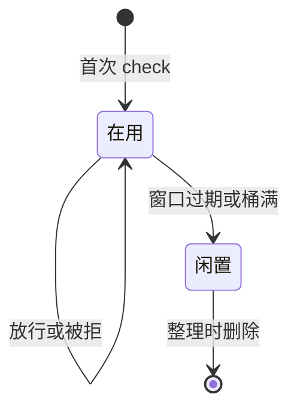

## Q
在 LLM 网关限流器里，每个 (client_id, endpoint) 在两种策略下各要存什么状态？哪条不变量最要紧，哪些写法会破坏它？

## A
**窗口存升序时间戳，令牌桶存（小数令牌，时刻）；最要紧的不变量：被拒零写入**

- **窗口：升序 `deque`**：队首清理 O(1)，长度只在放行时增加
- **令牌桶：`(tokens, stamp)`**：用到时才按流逝时间补，不起后台线程
- **夹住上限**：`min(capacity, …)`，容量调小时自动收敛
- **时间戳必须升序**：读时钟在锁内；先读后抢锁会乱序，队首挡住清理
- **每个 key 记自己的参数**：回收判闲置用它自己的窗口、容量、速率
- **回收只删等价于新建的**：窗口全过期、桶已满；门槛随规模翻倍



```python
class TokenBucket:
    def __init__(self, capacity, now):
        self._tokens = float(capacity)       # 新桶是满的
        self._stamp = now

    def _refilled(self, now, capacity, rate):
        elapsed_s = max(0, now - self._stamp) / 1e9
        return min(float(capacity), self._tokens + elapsed_s * rate)

    def decide(self, now, capacity, rate):
        tokens = self._refilled(now, capacity, rate)
        if tokens >= 1.0:                    # 只有放行才写回
            self._tokens, self._stamp = tokens - 1.0, now
```

<details class="pt"><summary>延伸</summary>字典涨到门槛才整理一次，门槛取整理后规模的 2 倍，扫描成本摊到每次 `check` 是 O(1)；换成 Redis 时用 TTL 代替整理。</details>

**知识点：** 限流器（Rate Limiter）、内存持久化（In-Memory Persistence）、复合操作（Compound Actions）
