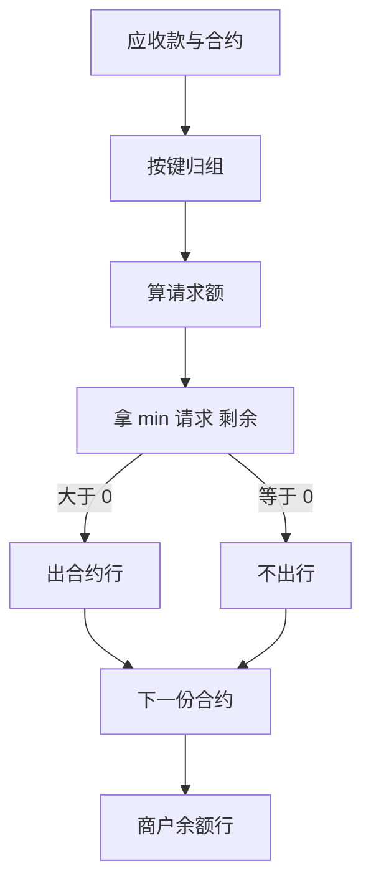

## Q
你要给支付结算系统写应收款分账（receivable allocation）：把同一天的卡交易汇总成应收款，再在若干合约和商户之间分钱。动手写之前，你会先定下哪几条规则，让隐藏测试没有可钻的空子？

## A
**三元组分组，百分比按原始金额向下取整，先到先得，商户行一行不少**

- **分组键**：(商户, 卡类型, 付款日) 精确匹配、区分大小写；客户编号不参与，重复行各算一次
- **请求额**：固定额取 `value` 分；百分比 = 原始金额 × 基点 // 10000，2500 基点 = 25%，永远不读剩余金额
- **实际拿到**：`min(请求, 剩余)`；合约按输入顺序先到先得；键不在应收款里的合约直接忽略
- **出行规则**：合约拿到正数才出行；每笔应收款输出一行商户余额，零也要出；不同合约不合并
- **整数与只读**：金额全程整数分；不改输入，返回新对象，重复调用互不影响



```python
def allocate_one(receivable, contracts):
    funds = Funds.of(receivable.amount)          # original 与 remaining
    rows = []
    for c in contracts:                          # 输入顺序
        want = c.value if c.kind == "fixed" else funds.original * c.value // 10_000
        granted = funds.take(want)               # min(请求, 剩余)
        if granted > 0:
            rows.append(Allocation(c.contract_id, receivable.card_type,
                                   receivable.payout_date, granted))
    rows.append(Allocation(receivable.merchant_id, receivable.card_type,
                           receivable.payout_date, funds.remaining))  # 零也出
    return rows
```

<details class="pt"><summary>延伸</summary>规则越细越要把 README 的数字例子先写成测试；取整方向、百分比的基数、零行要不要出这三处语义自己定，不交给编程智能体顺手选。</details>

**知识点：** 边界校验（Validate at the Boundary）、时间与数字（Time & Numbers）、不变量与封装（Invariants）
