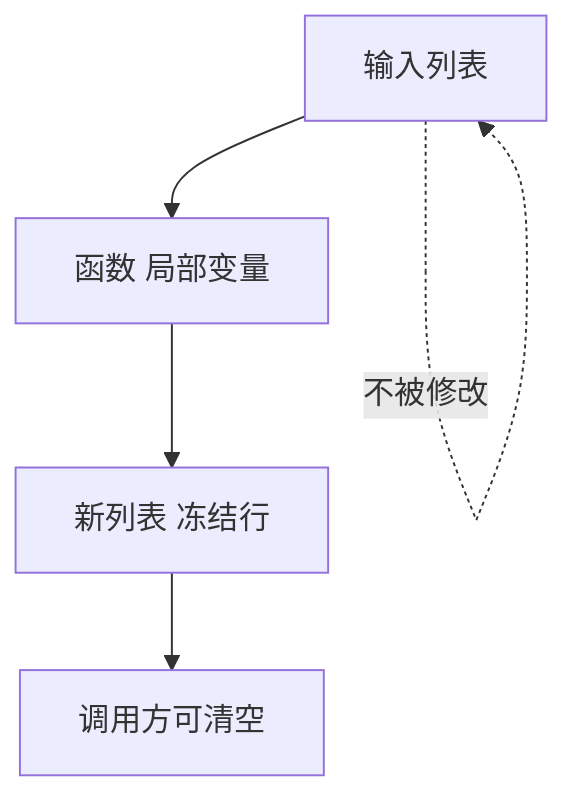

## Q
结算批处理会在同一个进程里反复调用分账函数：财务先拿结果对账，再把同一批输入原样重跑一遍；调用方还会直接把返回的列表清空重用。你怎样保证输入没被改、结果和输入互不相连、再跑一遍结果一样？你会加哪条测试，它能区分哪种错误？

## A
**记录冻结、函数无状态、输入只读；再用前后快照和对拍把它们钉住**

- **输入只读**：不对参数列表 `sort`、`pop`、`append`；要排序就 `sorted(...)` 得到新列表
- **结果隔离**：`Allocation` 是冻结的 dataclass，输出是新建的列表，不返回输入里的对象，也不返回内部字典
- **重复调用独立**：没有模块级缓存，没有可变默认参数，状态只活在一次调用的局部变量里
- **快照测试**：调用前后各取输入副本，调用两次；输入不变、两次结果相等且不是同一个列表，清空第一次结果后第二次不受影响；能抓到原地排序、返回内部列表、模块级缓存
- **对拍测试**：用 `Fraction` 的独立实现在随机数据上逐行核对，并断言各行之和等于应收款总额；能抓到取整、顺序、守恒错误



```python
def test_inputs_untouched_and_calls_independent():
    before = list(contracts)
    out1 = allocate(receivables, contracts)
    out2 = allocate(receivables, contracts)
    assert contracts == before            # 没有原地排序
    assert out1 == out2 and out1 is not out2
    out1.clear()                          # 调用方清空自己的结果
    assert allocate(receivables, contracts) == out2
```

<details class="pt"><summary>延伸</summary>数据放进数据库后，"输入只读"变成只读事务，"重复调用一样"变成幂等：同一批次编号写入两次只生效一次。</details>

**知识点：** 防御性拷贝（Defensive Copying）、值对象与不可变性（Value Objects）、不靠锁的线程安全（Immutability & Confinement）
