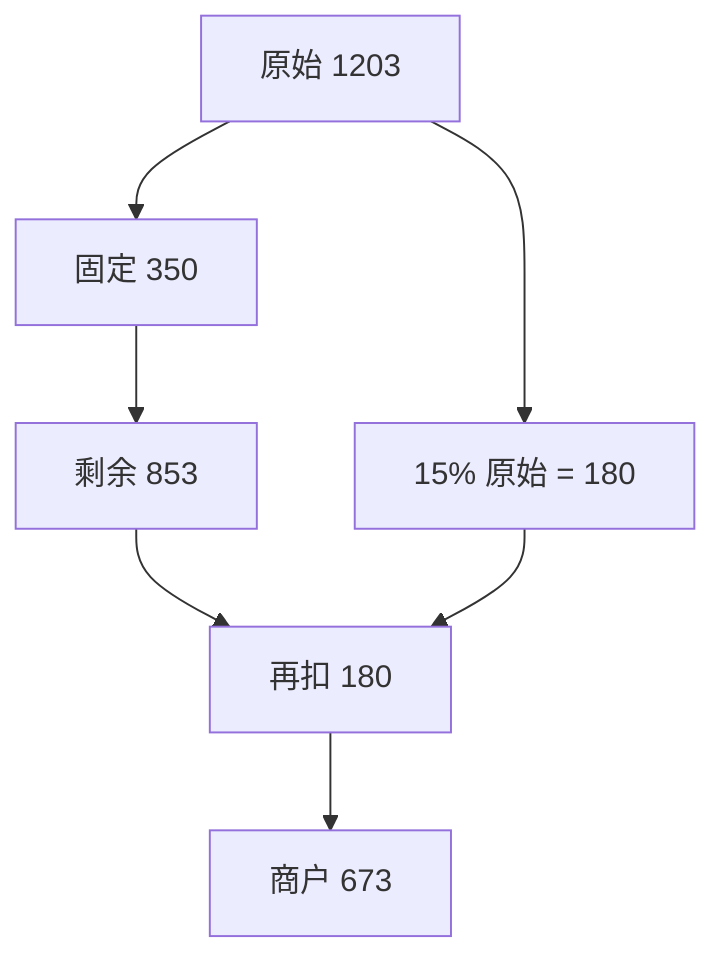

## Q
结算系统里，商户 Grocer 的一笔应收款汇总后是 1203 分，合约顺序是：先固定 350 分，再 15%。财务问你：这 15% 到底算 180 还是 127？你按什么规则定，又怎样用一个例子向同事证明两种算法不同？

## A
**百分比永远乘原始金额：180；乘剩余的 853 才是 127**

- **键与顺序**：先按 (商户, 卡类型, 付款日) 把交易汇总成 1203；同一个键的合约按输入顺序依次领钱
- **请求额**：15% 是 1500 基点，`1203 * 1500 // 10000 = 180`，180.45 向下取整
- **区分例子**：固定 350 之后，按原始金额算 P = 180，商户余额 673；按剩余 853 算 P = 127，商户余额 726
- **顺序只影响钱不够时**：百分比不读剩余，所以调换位置不改变请求额；只是钱不够时谁先领、谁少拿
- **钱不够**：后面再来一份固定 900，只拿到剩下的 673，商户行变成 0



```python
def test_percentage_uses_original_amount():
    contracts = [con("F", "fixed", 350), con("P", "percentage", 1500)]
    rows = allocate([rec(amount=1203)], contracts)
    got = {r.id: r.amount for r in rows}
    # 按剩余 853 算会得到 P=127、Grocer=726
    assert got == {"F": 350, "P": 180, "Grocer": 673}
```

<details class="pt"><summary>延伸</summary>要换成"按剩余算"只改 `requested_amount` 的一个参数，但会让百分比依赖合约顺序；数据规模变大时这条规则不变，变的是怎样按键并行。</details>

**知识点：** 时间与数字（Time & Numbers）、用例选择（Partitioning & Boundaries）、不变量与封装（Invariants）
