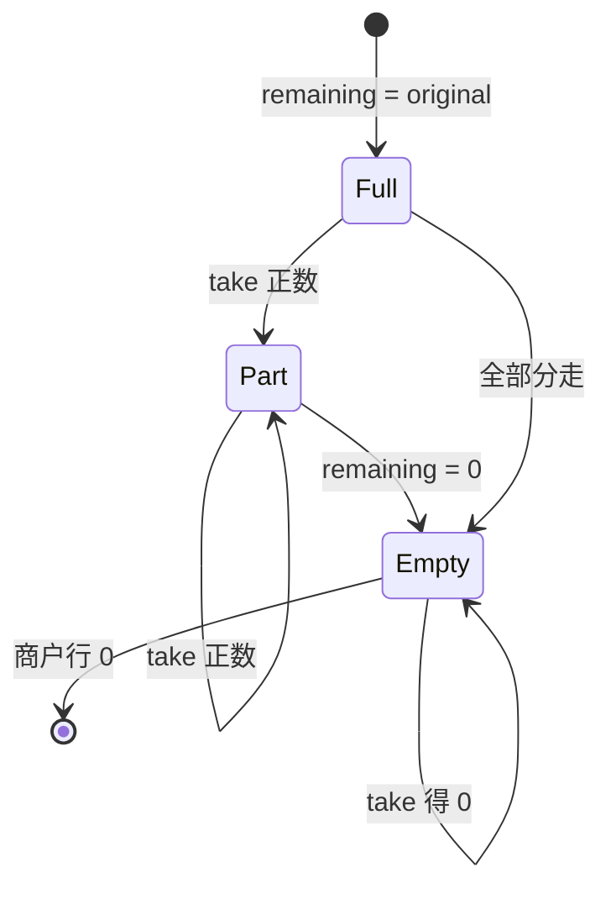

## Q
结算系统的应收款分账（receivable allocation）要处理一万笔应收款、一万份合约。你会存哪些状态，怎么把合约和应收款对上，哪条不变量最要紧？

## A
**每笔钱一个 Funds，合约按键一次归组；每笔应收款的各行之和必须等于它的金额**

- **Funds(original, remaining)**：百分比读 `original`，扣款只改 `remaining`；`0 ≤ remaining ≤ original`，只减不增
- **负请求会造钱**：`min(-5, remaining)` 是 -5，remaining 反而变大，所以 `take` 对负数抛 `ValueError`
- **逐笔守恒**：每笔应收款的各行之和等于它的金额，违反抛 `ConservationError`；不用 `assert`，`python -O` 会把它去掉
- **合约先归组**：一次遍历建 `dict[键, list]`，组内保持输入顺序，总成本 O(交易数 + 合约数)；一万 × 一万逐笔扫描要比较一亿次键，Python 3.14.8 上约 20 秒，归组约 0.01 秒
- **零头归商户**：取整丢掉的分留在 `remaining`；100 分、三份 3333 基点得到 33、33、33，商户行是 1



```python
@dataclass(slots=True)
class Funds:
    original: int
    remaining: int

    def take(self, requested: int) -> int:
        if requested < 0:
            raise ValueError(f"negative request: {requested}")
        granted = min(requested, self.remaining)
        self.remaining -= granted        # 只减不增
        return granted
```

<details class="pt"><summary>延伸</summary>键与键之间互不依赖，所以数据再大也能按键分片并行；换成数据库时，每个键内的先到先得要靠按合约顺序的累计和，不能拆成无序的批量更新。</details>

**知识点：** 不变量与封装（Invariants）、复杂度与常数（Complexity vs Constants）、按访问模式选结构（Choosing Structures）
