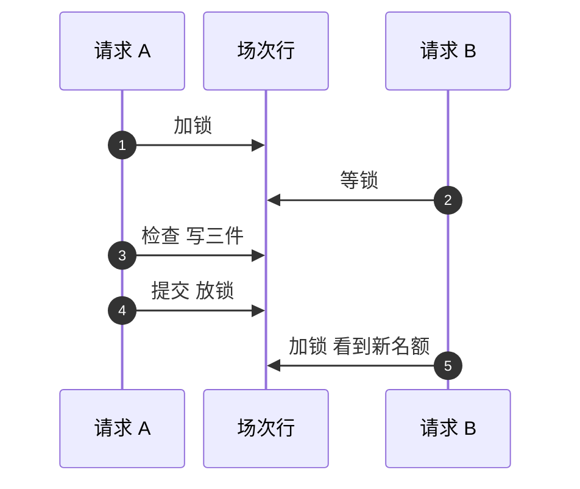

## Q
热门课程在预约服务（SlotWise）里开放的一瞬间，几十个请求同时抢最后几个名额，同一个用户的手机还会因为响应慢自动重试。你怎么让它不超卖、不出现重复预约，取消也只释放一次名额？

## A
**先锁场次那一行，再检查、再写三件事，一个事务提交；数据库约束兜底**

- **先锁**：`SELECT … FOR UPDATE` 锁场次行（SQLite 用 `BEGIN IMMEDIATE`），同场次的请求在这里排队
- **再检查**：场次在不在、是否已持有、是否已满，都在锁里做，读到的值不会过期
- **后写三件**：`available_slots - 1`（相对更新）、预约、审计，一次提交
- **取消同序**：先场次后预约；只有 active 才改并释放，重复取消直接返回现状
- **兜底**：唯一索引挡住绕开检查的写入；只把 SQLSTATE 23505 翻成 409，别的 IntegrityError 仍是 500
- **测试**：真线程加屏障，3 个用户共发 12 个请求抢 3 个名额，断言恰好 3 个成功、名额 0、审计 3 行



1. A 先拿到场次行的锁。
2. B 的同场次请求在锁上等待，不会读到 A 提交前的名额。
3. A 的检查和三次写入在同一个事务里，提交后锁释放。
4. B 拿到锁时读到的已经是 A 之后的名额，按新值判断。

```python
with transaction(db):                   # BEGIN IMMEDIATE
    session = db.execute("SELECT available_slots FROM sessions WHERE id = ?",
                         (session_id,)).fetchone()   # PG：… FOR UPDATE
    if session is None:
        raise ReservationNotFound("Session not found")
    if _holds_active(db, user_id, session_id):
        raise ReservationConflict("Already reserved")
    if session["available_slots"] <= 0:
        raise ReservationConflict("Session is full")
    # 里面第一句是相对更新 available_slots = available_slots - 1，
    # 然后插入预约、写审计：三件事在同一个事务里
    row = _write_reservation(db, user_id, session_id, stamp)
```

<details class="pt"><summary>延伸</summary>多实例部署时锁在数据库里，所以仍然正确；热门场次那一行成了串行点，吞吐受限于一个事务的时长，要缩短事务，别在锁里调外部服务。</details>

**知识点：** 复合操作（Compound Actions）、死锁及其亲戚、测试并发代码（Testing Concurrency）
