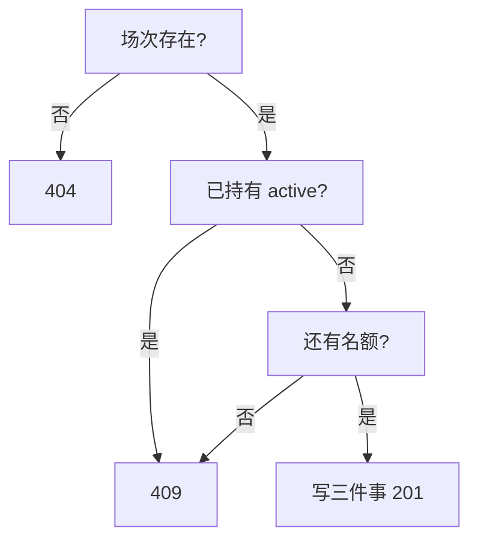

## Q
你被叫去处理预约服务（SlotWise）的线上事故：用户说重试之后出现两条预约、不同页面看到的剩余名额不一致、取消之后界面互相矛盾，生产库里还有对不上的历史记录。动手改代码之前，你会先定下哪几条规则？

## A
**重复预约 409、名额恒等式、取消幂等且不泄露、三件事同成败、修复不删行**

- **预约的判断顺序**：场次不存在 404（`Session not found`）→ 已持有 active 409 → 已满 409；失败什么都不改
- **名额恒等式**：`available_slots = 容量 − active 数`；取消后同一用户可再预约，是新预约、新 id
- **取消按主人隔离**：别人的预约和不存在的一样 404；主人重复取消 200、正文不变、名额只释放一次、审计只一行
- **三件事同成败**：预约状态、名额、审计在一个事务里，任何一步失败都不留痕
- **Dashboard**：只含自己的、只含该状态的预约；响应字段、路径、状态值都不能改
- **修复规则**：同一用户同一场次最早的留下（同刻取小 id），超容量再按同序留到上限；cancelled_at 同一个时刻，不补审计



```python
def reserve(db, *, session_id, user_id, now=None):
    stamp = _stamp(now)
    with transaction(db):  # 先锁，再查，后写
        session = db.execute("SELECT available_slots FROM sessions "
                             "WHERE id = ?", (session_id,)).fetchone()
        if session is None:
            raise ReservationNotFound("Session not found")
        if _holds_active(db, user_id, session_id):
            raise ReservationConflict("Already reserved")
        if session["available_slots"] <= 0:
            raise ReservationConflict("Session is full")
        row = _write_reservation(db, user_id, session_id, stamp)
    return Reservation.from_row(row)
```

<details class="pt"><summary>延伸</summary>规则先写下来再让智能体动手：每条规则配一个数字例子和一个会失败的测试；两条 409 对客户端没有区别，但要在正文里分开，排查才快。</details>

**知识点：** 接口的错误契约（Error Contract）、不变量与封装（Invariants）、非法转移与幂等（Illegal Transitions）
