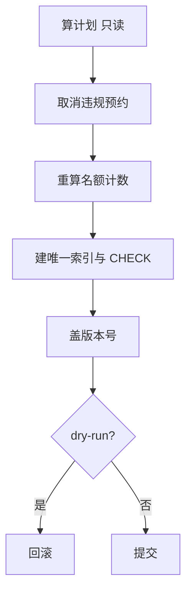

## Q
预约服务（SlotWise）的生产库里已经有了脏数据：同一用户对同一场次有多条 active，有的场次 active 数超过容量，剩余名额的计数也对不上，而且生产库不能重置。你怎么写这次数据修复，才能安全地预演和应用？

## A
**一个事务：算计划、取消违规行、重算计数、建约束、盖版本号；dry-run 就是做完回滚**

- **先算后做**：计划是只读函数，返回要取消的 id 和要改的计数；dry-run 与真跑共用它
- **规则有先后**：先去重（最早留下，同刻取小 id），再按容量留到上限；颠倒会让重复记录占掉别人的名额
- **只改状态**：取消的行 `cancelled_at` 是同一个时刻，不删行、不补审计、不碰其他行
- **先数据后约束**：脏数据上建唯一索引会失败；建好之后同类脏数据写不进来
- **幂等**：只碰违反规则的行，第二次运行什么都不改，第一次的 `cancelled_at` 也不被覆盖
- **预演不是全部**：本地快照只是生产的节选；以 dry-run 的 diff 与只读一致性检查为准



```python
def plan_repair(db):  # 只读：返回要取消的 id
    rows = db.execute(ACTIVE_WITH_CAPACITY).fetchall()  # ORDER BY created_at, id
    cancelled, holders, kept = [], set(), Counter()
    for r in rows:                        # 规则 1：同用户同场次留最早
        key = (r["user_id"], r["session_id"])
        if key in holders:
            cancelled.append(r["id"])
        holders.add(key)
    survivors = [r for r in rows if r["id"] not in cancelled]
    for r in survivors:                   # 规则 2：再按容量留到上限
        if kept[r["session_id"]] >= r["capacity"]:
            cancelled.append(r["id"])
        else:
            kept[r["session_id"]] += 1
    return sorted(cancelled)
```

<details class="pt"><summary>延伸</summary>表很大时，在 PostgreSQL 里用 row_number() 窗口函数写成两条 UPDATE，并在事务里先锁住写入；在线建索引要用 CREATE INDEX CONCURRENTLY，那不能放进事务，要拆成单独的迁移。</details>

**知识点：** 所有路径上的清理（Cleanup on Every Path）、用例选择（Partitioning & Boundaries）、风险与权限（Risks & Guardrails）
