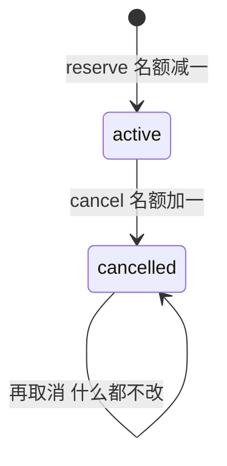

## Q
在预约服务（SlotWise）里，每个场次的剩余名额、每个人的预约、每次操作的审计分别存在哪里？要存哪些状态？哪条不变量最要紧，什么写法会打破它？

## A
**名额是一个冗余计数器，必须永远等于容量减 active 数；唯一索引和 CHECK 让数据库替你守住**

- **三张表**：`sessions`（容量、剩余名额）、`reservations`（用户、场次、状态、创建与取消时间）、`reservation_audits`（只追加）
- **最要紧的不变量**：`available_slots = capacity − active 数`，且同一 (用户, 场次) 至多一条 active
- **为什么有冗余**：列表页直接读计数器，不用每次数预约；代价是每次改预约都要同事务改计数器
- **打破它的写法**：读出再写回绝对值（丢更新）、预约与名额分两次提交、取消不看状态就加一
- **数据库兜底**：部分唯一索引加 `available_slots <= capacity`；应用代码出错也写不进坏数据
- **审计只追加**：每次成功恰好一行；取消的预约不删、不改回 active



```python
CONSTRAINTS = (
    """CREATE UNIQUE INDEX uq_reservations_one_active
       ON reservations (user_id, session_id) WHERE status = 'active'""",
    """CREATE TRIGGER trg_slots_within_capacity_update
       BEFORE UPDATE ON sessions
       WHEN NEW.available_slots > NEW.capacity
       BEGIN SELECT RAISE(ABORT, 'available_slots exceeds capacity'); END""",
)
# PostgreSQL：ALTER TABLE sessions ADD CONSTRAINT ck_… CHECK (available_slots <= capacity)
```

<details class="pt"><summary>延伸</summary>可以去掉计数器、每次现数 active；列表多一次聚合，换来没有"计数器与现实不一致"这一类事故。保留计数器就必须保留约束和一致性检查查询。</details>

**知识点：** 不变量与封装（Invariants）、内存持久化（In-Memory Persistence）、复合操作（Compound Actions）
