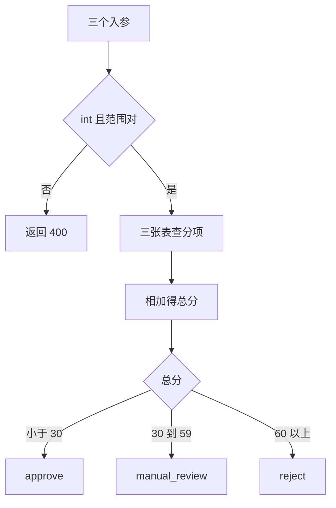

## Q
在退货风险评分服务（ReturnGuard）里，要修复评分引擎：`evaluate` 返回总分、决定和三个分项，`evaluate_many` 批量处理。现有代码在阈值边界上前后不一致。开工前你会先定下哪几条规则？

## A
**先把合同写成六条带数字的断言，再改代码。**

- **校验在计算之前**：评分 1..5，金额与账龄非负，类型恰好 `int`；`True`、`3.0`、`'3'`、`None` 都是 `ServiceError(400, "invalid_input")`
- **下界全部含**：金额 10000 与 50000、账龄 30 与 180、总分 30 与 60 恰好落在边界时归更高一档
- **总分是三项原样之和**：最大 95，不取整、不截断；返回恰好 `score`、`decision`、`components`
- **批量一条一结果**：`{result, error}`，无效项的 `error` 是 `"invalid_input"`，保序，坏记录不影响后面，空输入 `[]`
- **输入只遍历一次**：迭代器自己的异常原样抛出
- **无状态**：返回的字典每次现建，不修改传入的记录



```python
def evaluate(self, rating, value_cents, account_age_days):
    if not (type(rating) is int and 1 <= rating <= 5
            and type(value_cents) is int and value_cents >= 0
            and type(account_age_days) is int and account_age_days >= 0):
        raise ServiceError(400, "invalid_input")
    p = self._policy
    r = p.rating_points[rating - 1]
    v, a = p.value.at(value_cents), p.age.at(account_age_days)
    return {"score": r + v + a, "decision": p.decision.at(r + v + a),
            "components": {"rating": r, "value": v, "age": a}}
```

<details class="pt"><summary>延伸</summary>

规则数量变多时，每条规则对应一个带数字的测试；`(1, 50000, 10)` 得 95 分、reject 这类合同例子是第一批测试。

</details>

**知识点：** 边界校验（Validate at the Boundary）、接口的错误契约（Error Contract）、验证输出（Verification）

