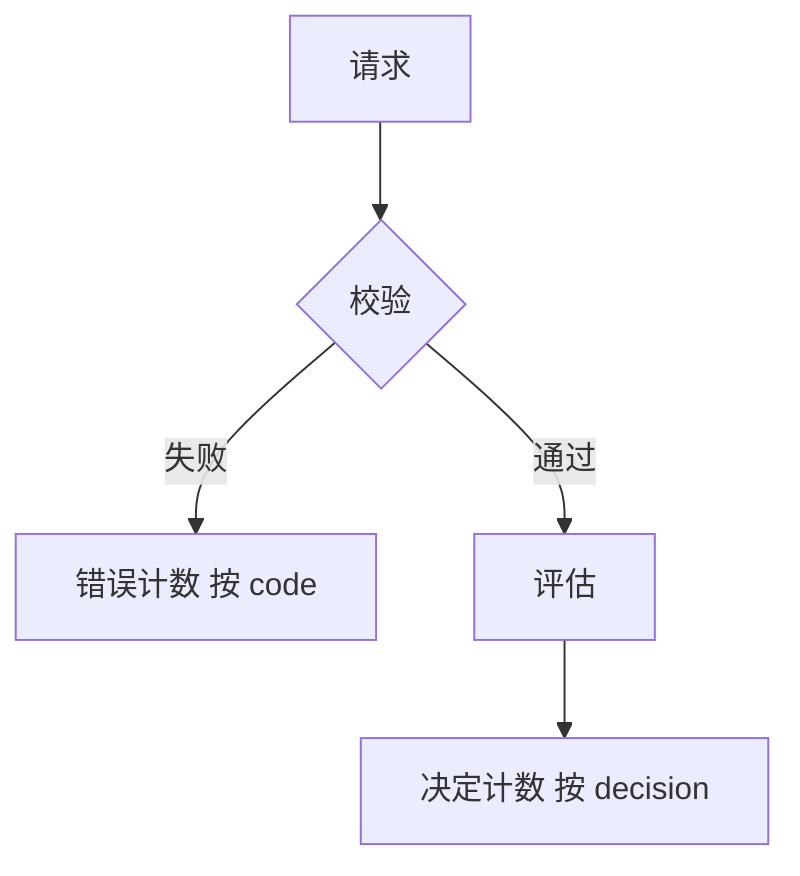

## Q
在 ReturnGuard 的监控里，“无效输入”和“策略拒绝”都表现为请求没通过。说明指标怎样区分这两者，为什么不能混在一起，批量里又怎么计。

## A
**无效输入是错误，策略拒绝是成功的决定：分开计数，分开告警。**

- **信号不同**：无效输入是 `invalid_input`（400）、没有分数；策略拒绝是成功评估，`decision` 为 reject，有分项
- **指标分开**：错误计数器按错误码打标签，决定计数器按 `decision` 打标签
- **批量里**：`error` 非空计无效输入，`result.decision` 为 reject 计拒绝，两类不重叠
- **为什么不混**：无效输入上升多半是上游缺陷或攻击，拒绝率上升是业务或策略变化，告警对象不同
- **标签基数**：只用错误码与决定这样的有限枚举，不放用户编号



```python
for out in engine.evaluate_many(records):
    if out["error"] is not None:
        invalid.labels(code=out["error"]).inc()
    else:
        decisions.labels(d=out["result"]["decision"]).inc()
```

<details class="pt"><summary>延伸</summary>

拒绝率突变时先看是否上了新策略版本：把 `policy_version` 作为日志字段或标签（版本数有限），再排查业务原因。

</details>

**知识点：** 接口的错误契约（Error Contract）、错误类型体系（Error Taxonomy）、缺陷与预期失败（Bugs vs Failures）

