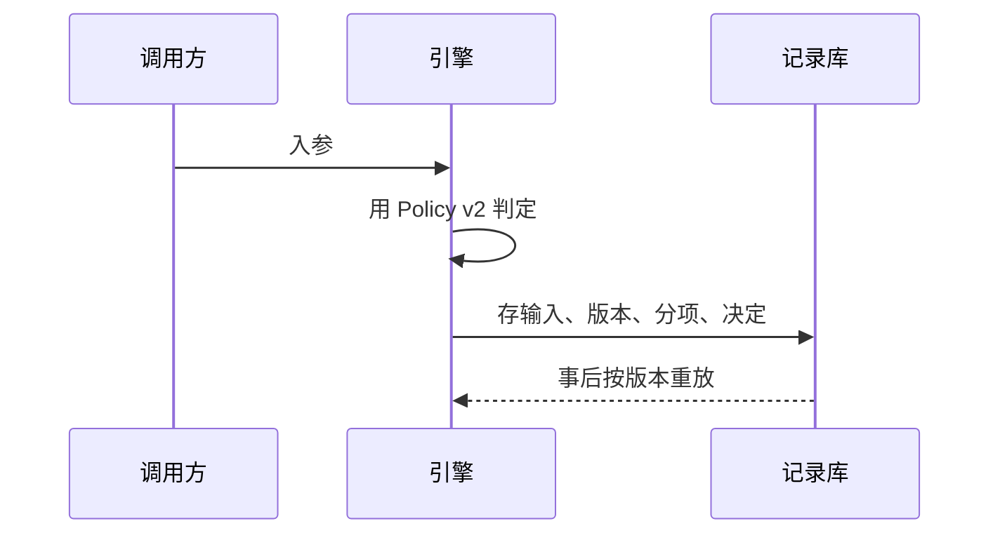

## Q
ReturnGuard 的评分规则以后会调整。说明策略版本化如何让历史决定仍然可以解释：策略怎么存、每个决定记什么、怎么重放核对、代价是什么。

## A
**策略是带版本号的不可变数据；每次判定存一条可重放的记录。**

- **不可变版本**：`v1` 永远是 `v1`，改规则发 `v2`，不原地修改
- **判定记录**：输入、策略版本、三个分项、总分、决定，`assess` 返回的就是它
- **重放**：取记录里的版本与输入重算，应得同样的结果，不一致就是回归
- **保留**：历史版本全部留着，记录各自的生效时间，不删除
- **代价**：存储变大；输入含个人信息要按保留期处理；版本多了要有退役办法



```python
POLICIES = {"v1": POLICY_V1, "v2": POLICY_V2}  # 全部保留

def replay(rec):  # rec 是存下来的 Assessment
    again = RiskEngine(POLICIES[rec.policy_version]).assess(
        rec.rating, rec.value_cents, rec.account_age_days)
    return again == rec  # 不一致就是回归
```

<details class="pt"><summary>延伸</summary>

规则多了就把策略放进数据库、按生效时间取，同样不可变；把重放检查放进每次发布的流程。

</details>

**知识点：** 不变量与封装（Invariants）、字段演进（Schema Evolution in Code）、值对象与不可变性（Value Objects）

