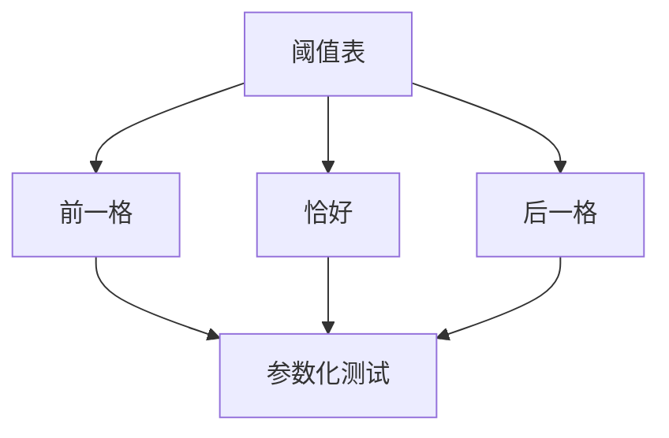

## Q
在 ReturnGuard 评分引擎里，说明你是如何选择阈值附近的测试的：测哪些点、为什么这样选、两层阈值（分项与决定）怎么避免互相遮盖。

## A
**每个阈值测三点，分项与决定分层测，期望值独立写成表。**

- **三点**：下界前一格、恰好、后一格，例如金额 9999、10000、10001
- **分层**：测总分 30、60 时，用金额与账龄都不压边界的输入，如 `(3, 0, 100)`、`(3, 20000, 0)`
- **可达性**：总分都是 5 的倍数，29 与 59 取不到，决定边界用 25 与 30、55 与 60
- **独立期望**：期望值写成表，不从被测代码里抄
- **极值**：0、`10**18`、负数、`True`



```python
CASES = [  # (入参, 总分, 决定)，独立写成表
    ((5, 0, 0), 25, "approve"),
    ((3, 0, 100), 30, "manual_review"),
    ((1, 20000, 365), 55, "manual_review"),
    ((3, 20000, 0), 60, "reject"),
]

@pytest.mark.parametrize("args, score, decision", CASES)
def test_decision_edges(args, score, decision):
    r = RiskEngine().evaluate(*args)
    assert (r["score"], r["decision"]) == (score, decision)
```

<details class="pt"><summary>延伸</summary>

金额阈值改动时，这张表是唯一要改的测试数据；再补一条性质测试：随机合法输入下总分始终等于三个分项之和。

</details>

**知识点：** 为测试而设计、边界校验（Validate at the Boundary）、验证输出（Verification）

