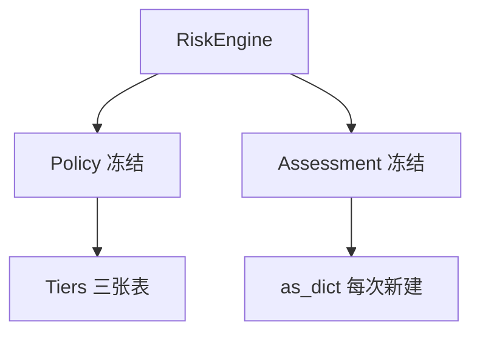

## Q
在退货风险评分引擎里，同一台服务会被许多请求反复调用 `evaluate`。要存哪些状态？哪条不变量最要紧？什么会打破它？

## A
**状态只有一份只读策略；最要紧的不变量是结果只由入参与策略版本决定。**

- **只读策略**：评分表、金额表、账龄表、决定表放进冻结的 `Policy`，引擎持有但从不写
- **最要紧的不变量**：同样的入参永远得到同样的结果，与调用次序、次数、线程无关
- **分段表不变量**：从 0 起、下界严格升序、每个非负整数恰有一段，构造时就校验
- **会打破它的做法**：模块级缓存返回同一个字典、实例上存“上一次结果”、可变默认参数
- **规则是数据**：（下界，值）表加 `bisect_right`，边界只有一种写法



```python
@dataclass(frozen=True)
class Tiers:
    bounds: tuple[int, ...]
    values: tuple[int, ...]

    def __post_init__(self):
        up = all(a < b for a, b in zip(self.bounds, self.bounds[1:]))
        if not (self.bounds[:1] == (0,) and up
                and len(self.bounds) == len(self.values)):
            raise ValueError("bad tiers")

    def at(self, x):
        return self.values[bisect_right(self.bounds, x) - 1]
```

<details class="pt"><summary>延伸</summary>

要加缓存时缓存冻结的 `Assessment`，对外每次 `as_dict()` 新建；无状态也让引擎实例可以随意复制到多个进程。

</details>

**知识点：** 不变量与封装（Invariants）、值对象与不可变性（Value Objects）、不靠锁的线程安全（Immutability & Confinement）

