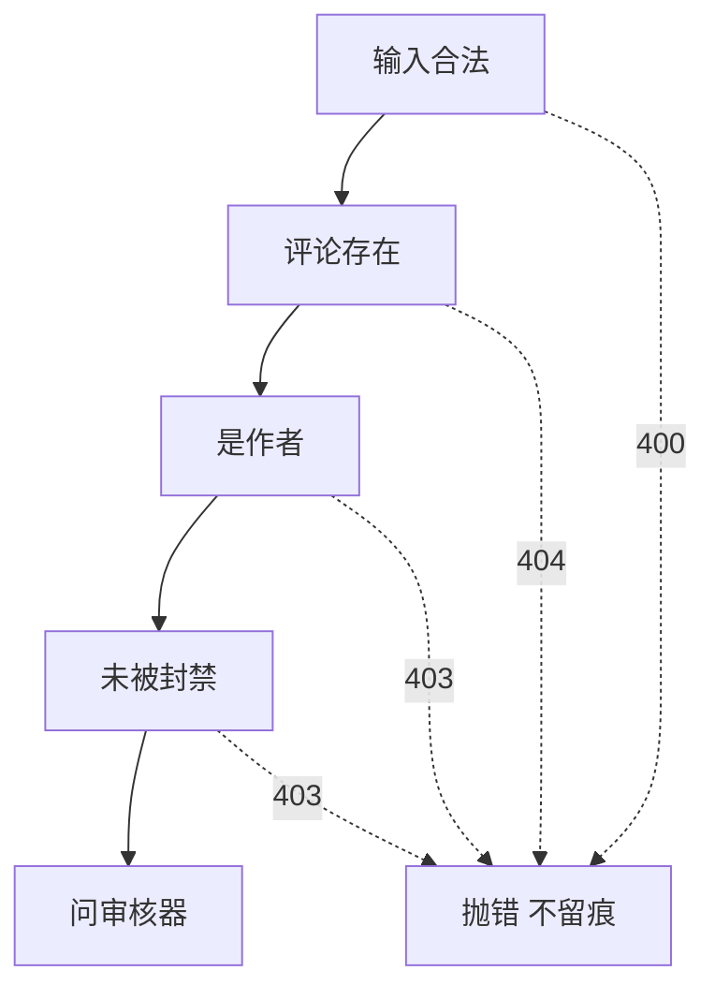

## Q
你接手一个评论审核服务（ReviewDesk）：新建和编辑评论都要先过一个外部审核器。反馈是违规内容漏过、同一个人反复发违规、审核器宕机时评论照样发布。动手改代码之前，你会先定下哪几条规则？

## A
**违规数只增不减，第三次起封禁；审核器出错既不算违规，也不放行**

- **审核器收原文**：每次合格的写入恰好问一次，参数是没动过的内容（不转小写、不去空白）
- **违规数永久**：被拒恰好加一；成功写入不清零；`flagged` 就是 `strikes >= 3`
- **第三次仍报被拒**：状态变成 `3 / True`；此后合格的写入一律 `user_blocked`，不问审核器，也不再加违规
- **顺序固定**：新建 输入 → 封禁 → 审核器；编辑 输入 → 存在 → 归属 → 封禁 → 审核器
- **失败不留痕**：被拒、被封、审核器出错都不占 id、不改评论；编辑成功才加版本（内容相同也加）
- **审核器抛 Exception 是 503**：不记违规；`BaseException` 不拦



```python
def edit(self, review_id, user, content):
    _require_text(user)
    _require_text(content)                         # 400
    with self._lock:
        current = self._find(review_id)            # 404
        if current.user != user:
            raise ServiceError(403, "forbidden")
        self._moderate(user, content)              # 403 封禁 / 503 / 422
        updated = current.edited(content)          # 版本加一
        self._reviews[review_id] = updated
        return updated.snapshot()
```

<details class="pt"><summary>延伸</summary>错误码的先后就是合同：同一个请求同时犯两个错，调用方看到哪个由顺序决定；换成 HTTP 接口时顺序不变，状态码照搬。</details>

**知识点：** 规格与契约（Specifications）、边界校验（Validate at the Boundary）、异常与错误值（Exceptions vs Values）
