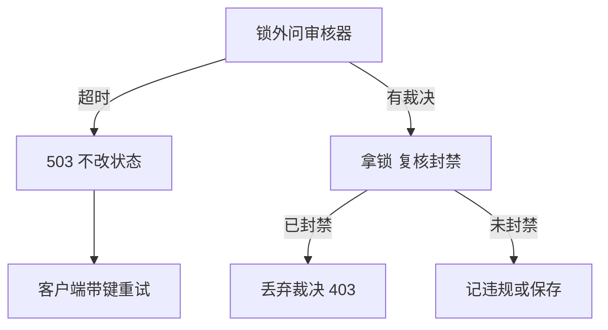

## Q
评论审核服务（ReviewDesk）的审核器改成了远程 HTTP 服务，偶尔三秒不回话，用户点了发布就卡住。运维说超时之后可以重试。你要怎样调整写入的约定，让评论、违规数和 id 不出岔子？

## A
**超时就是 503，状态不变；重试要安全，锁不能罩住远程调用**

- **超时等同审核器出错**：映射成 `checker_unavailable`，不记违规，也不放行；放行让坏内容在宕机时发布，记违规冤枉用户
- **给调用设期限**：客户端超时（如 2 秒）小于上游的超时，别让一次调用无限占着资源
- **锁外问审核器**：否则一个慢请求让所有用户排队；锁内只做"复核后提交"
- **提交时复核**：回到锁内再看一次封禁；等待期间已被封，就丢掉这次裁决、报 `user_blocked`，违规数仍不超过三
- **约定变弱了**：到达审核器的次数不再恰好是三次，只保证违规数不超过三；这条要写进合同
- **幂等键**：重试带客户端请求 id，同一个键只落一条评论，超时后的重试不会发出两条



```python
def create(self, user, content):
    with self._lock:
        if self._strikes.is_blocked(user):
            raise ServiceError(403, "user_blocked")
    allowed = self._ask_checker(content)     # 锁外，带期限；超时抛 503，什么都没改
    with self._lock:
        if self._strikes.is_blocked(user):   # 等待期间可能已被别的请求封禁
            raise ServiceError(403, "user_blocked")
        if not allowed:
            self._strikes.add(user)
            raise ServiceError(422, "content_rejected")
        ...                                  # 取 id，保存，返回快照
```

<details class="pt"><summary>延伸</summary>重试多了要加退避与熔断：审核器连续超时时，快速失败比让所有请求各等两秒更体面。</details>

**知识点：** 取消、超时与关闭（Cancellation & Shutdown）、重试与退避（Retry & Backoff）、复合操作（Compound Actions）
