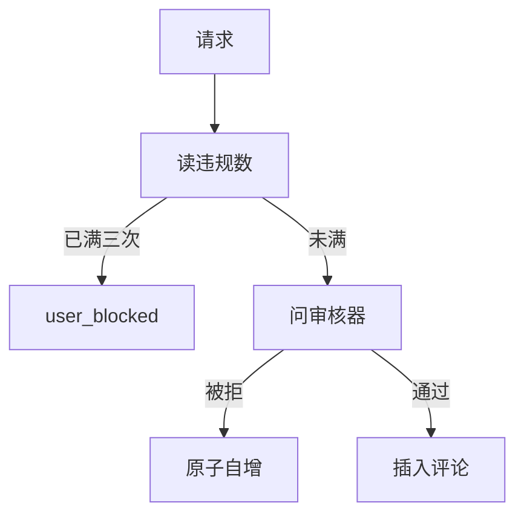

## Q
评论审核服务（ReviewDesk）每周重启一次，重启后所有用户的违规数归零，被封的人又能发评论了。要让违规记录跨重启保留，并且仍然在恰好第三次被拒时封禁，你会怎么改？

## A
**违规数进数据库，记一次违规是一条原子 SQL，封禁现算**

- **违规表**：`strikes(user PRIMARY KEY, count)`；`flagged` 还是 `count >= 3` 现算，不另存标志位
- **原子自增**：`INSERT … ON CONFLICT DO UPDATE SET count = count + 1 RETURNING count`，多个进程同时记也不丢次数
- **以返回值为准**：两个进程同时读到 2、同时问审核器，各自自增，返回 3 和 4；封禁线不会被漏过去
- **评论与违规同一个事务**：被拒的编辑只写违规表，成功的编辑才写评论行，一起提交或一起回滚
- **通过之后才插入评论**：id 由库的整数主键给，被拒的写入没有占号
- **启动时不用加载**：每次请求现读，重启之后状态就是库里的状态



```python
def add_strike(conn, user):
    with conn:                                    # 一个事务
        row = conn.execute(
            "INSERT INTO strikes (user, count) VALUES (?, 1)"
            " ON CONFLICT (user) DO UPDATE SET count = count + 1"
            " RETURNING count",
            (user,),
        ).fetchone()
    return row[0]                                 # 到 3 就封禁
```

<details class="pt"><summary>延伸</summary>要审计"为什么被封"时，再加一张只追加的违规事件表（用户、评论、时间），计数表由它汇总而来，两者在同一个事务里写。</details>

**知识点：** 内存持久化（In-Memory Persistence）、原子操作与无锁（Atomics & Lock-Free）、不变量与封装（Invariants）
