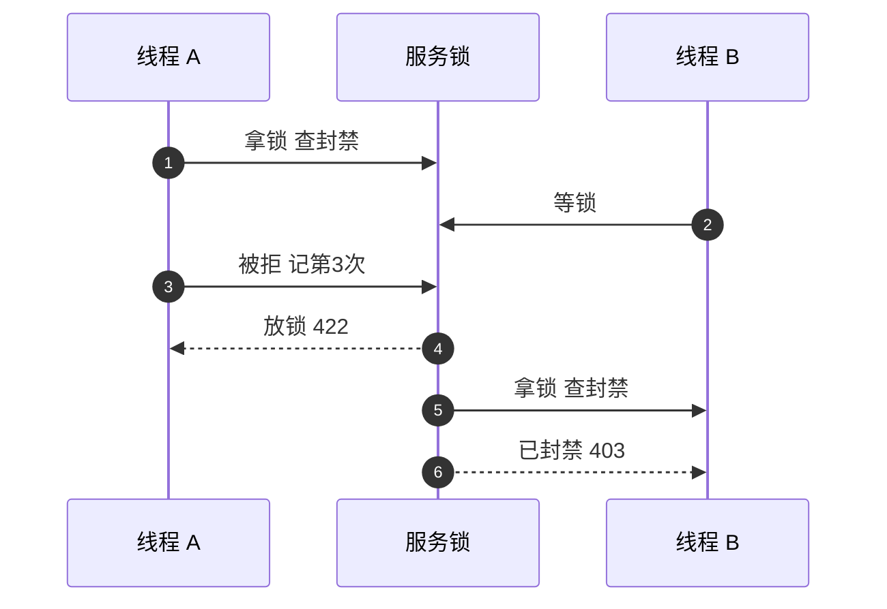

## Q
评论审核服务（ReviewDesk）里，某用户已被拒两次，两个线程同时拿他的两条违规内容来新建，审核器每次要几十毫秒。服务要记住哪些状态？哪条不变量最要紧，怎样保证第三次被拒之后，没有第四个请求到达审核器？

## A
**三份状态；"问审核器 → 记违规"必须是一个不可分的整体**

- **评论表**：id 到冻结的 `Review`；编辑是造新值再替换，所以失败的编辑没碰过旧值
- **违规本**：用户到次数，只增不减；`flagged` 由次数现算，没有第二份标志位可以对不上
- **下一个 id**：审核通过之后才取，失败路径没有要回滚的东西
- **最要紧的不变量**：判决与它那一次违规计数，在同一个临界区里一起落定；否则两个线程都读到"未封禁"，都问审核器，计数冲过三
- **锁罩住审核器调用**：代价是慢审核器让所有用户排队；换来"第三次之后到不了审核器"可以直接证明
- **用可重入锁**：审核器回头读服务（`get`、`user_state`）时不会把自己锁死



```python
def _moderate(self, user, content):      # 调用者已持锁
    if self._strikes.is_blocked(user):
        raise ServiceError(403, "user_blocked")
    try:
        allowed = self._checker(content)
    except Exception as exc:
        raise ServiceError(503, "checker_unavailable") from exc
    if not allowed:
        self._strikes.add(user)          # 判决与计数在同一个临界区
        raise ServiceError(422, "content_rejected")
```

<details class="pt"><summary>延伸</summary>吞吐不够时改成每用户一把锁：同一用户串行、不同用户并行，评论表与 id 另用一把短锁；多进程时这把锁换成数据库里的原子自增。</details>

**知识点：** 不变量与封装（Invariants）、复合操作（Compound Actions）、把标志位改成状态（Flags to States）
