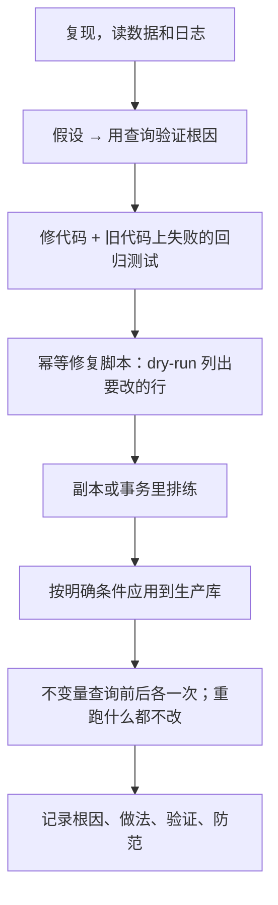

## Q
在 LeetCode Project 的线上事故类项目里，服务已经在生产库里留下了脏数据（例如数量对不上、取消之后留下残余状态），你和智能体要找出根因、修好代码，并修复已有数据。你怎么推进？数据修复怎么做才安全？

## A
**评分点**
- 说出先复现并找根因：读数据和日志，形成假设并用查询验证，再改代码，不先动手改
- 说出代码修复配回归测试：先写一个在旧代码上失败的用例
- 说出数据修复写成幂等的脚本，并带 dry-run 模式，先预演只列出会改什么
- 说出在副本或事务里先排练，再对生产库应用；范围按明确的条件限定，能回滚
- 说出用不变量查询验证：修复前后各查一次，修复后再跑一次应当什么都不改
- 说出记录下来：根因、修复内容、验证结果和后续防范，写进书面问题或说明里

参考答案

先复现、读数据，用查询验证根因的假设，再修代码并补一个旧代码上会失败的回归测试。数据修复写成幂等脚本，带 dry-run：先预演列出要改的行，在副本或事务里排练，再按明确条件应用到生产库。修复前后各跑一次不变量查询，再跑一遍脚本确认什么都不再改。最后把根因、做法、验证结果记录下来。

**知识点：** 假设驱动（Hypothesis-Driven）、稳定复现（Reproduce）、验证输出（Verification）
