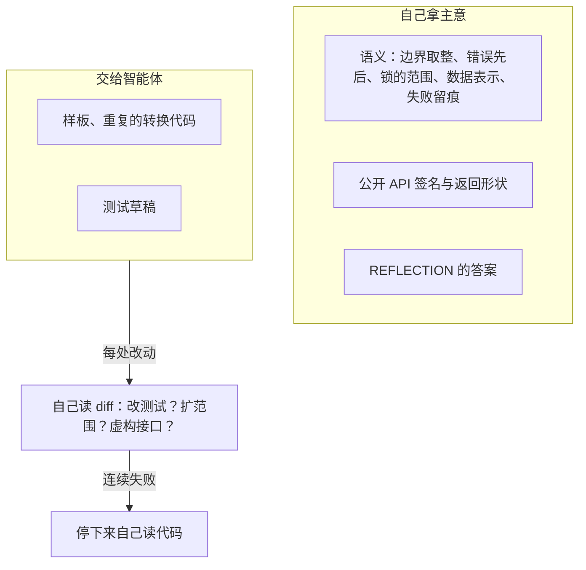

## Q
在 LeetCode Project 里，智能体对你说"我可以把整个模板一次写完，连 REFLECTION 的书面问题也替你答"。你同意吗？哪些东西必须留在你自己手里？

## A
**评分点**
- 说出隐藏测试会针对的设计决定自己拿主意：边界与取整、错误先后、锁的范围、数据表示、失败后是否留痕
- 说出公开 API 的签名与返回形状自己守住：提交后由现成代码调用
- 说出 REFLECTION 的答案必须自己写：问的是你的实现，要引用真实的锁、结构、代价，由你署名负责
- 说出智能体的每一处改动都要自己读 diff：看它有没有改测试、悄悄扩大范围、虚构接口
- 说出可以交出去的是边界清楚、容易验证的样板、重复的转换代码和测试的草稿
- 说出遇到连续失败时自己停下来读代码，而不是让它反复重试

参考答案

不同意一次写完。语义决定留给自己：边界取整、错误优先级、锁罩住哪几步、数据怎么存、失败后留下什么；公开签名也由我守。REFLECTION 问的是我的实现，必须自己写。智能体适合写样板和测试草稿。它每次的改动我都读 diff，看有没有改测试、扩大范围或编出不存在的接口；连续两次修不好就停下来自己读。

**知识点：** 该交给 AI 还是自己写（When to Delegate）、AI 的典型错误（Failure Modes）、验证输出（Verification）
