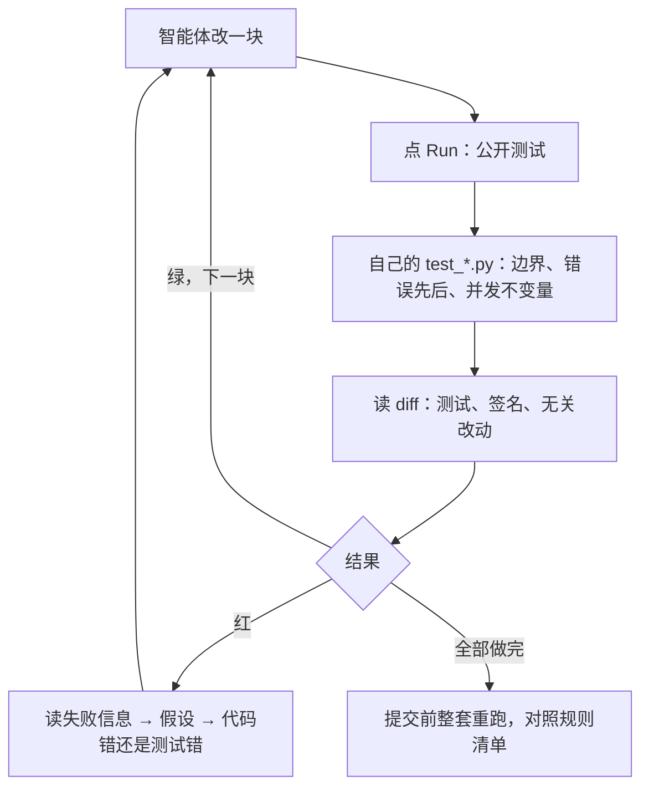

## Q
在 LeetCode Project 里，公开测试是只读的，点 Run 运行；提交时才会跑隐藏测试。你已经让智能体写完第一块，用掉 18 分钟。之后每次智能体改完代码，你按什么节奏验证？

## A
**评分点**
- 说出每次改动之后先点 Run 跑公开测试，不攒到最后一起跑
- 说出再跑自己写的测试：公开测试没覆盖的合同规则（边界值、错误先后、被拒不留痕）写进新的 test_*.py，在终端用 python3 -m pytest 跑
- 说出读 diff：确认没有改测试、没有改公开签名、没有多出无关改动
- 说出红灯时先复现并读失败信息、形成假设，再决定是代码错还是测试错，不能让智能体改测试迁就代码
- 说出涉及并发时用线程和屏障写不变量测试，不用 sleep 碰运气
- 说出提交前把全部测试再跑一遍，并对照规则清单逐条过一次

参考答案

节奏是：智能体改一块，我先点 Run；再跑自己的 `test_*.py`（合同里公开测试没覆盖的规则、边界值、并发不变量），然后读 diff。变红时先读失败信息、做假设，判断是代码错还是测试错，不让它改测试迁就代码。提交前整套再跑一遍，对着规则清单逐条核对。

**知识点：** 验证输出（Verification）、AI 的典型错误（Failure Modes）、假设驱动（Hypothesis-Driven）
