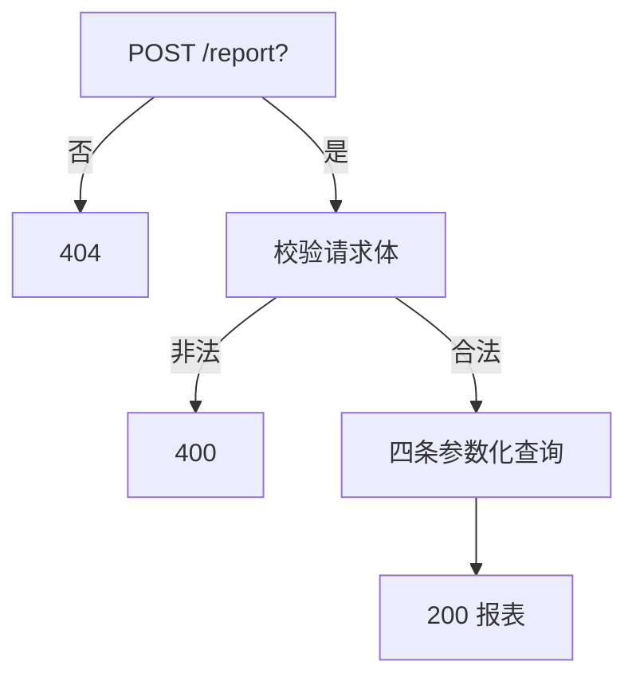

## Q
你要写销售报表接口：`POST /report` 按日期区间和可选筛选，在 SQLite 的 `sales` 表上算三个总数和三个排行榜。开工前你会先定下哪几条规则（隐藏测试会逐条卡的那几条）？

## A
**先把"谁算数、区间怎么切、怎么排"写成断言，再写 SQL。**

- **资格先于筛选**：`type` 是 `sale`、日期非空、状态是 `active` 或 `termed`；缺日期、缺状态、未知状态的行永远不算
- **区间左闭右开**：`start` 含、`end` 不含；`end` 还可以是 `2100-01-01`（只能做 end），2099-12-31 的销售才报得出；`end` 必须晚于 `start`
- **参数校验**：`k` 是 1–20 的整数，缺省 10，`null`、布尔、小数都是 400；未知字段、空串或超过 100 个码点的地区与商品也是 400
- **筛选是精确匹配**：区分大小写、不去空白、`%` 只是字符；具体的 `region` 匹配不到 NULL 地区；每个筛选对报表的每个部分生效
- **三个数各算各的**：`active_customers` 是 active 行里不同的客户数；总量与总额各自求和，价格不乘数量
- **排行的平局**：数值降序、再按键升序（UTF-8 字节序），先排序再截 k；没有匹配行时标量是 0、数组是空
- **形状**：非法请求 400 `invalid_request`，其他方法与路径 404 `not_found`；所有查询返回的行数合计 ≤ 32 + 3k



```python
MATCHING = """
    type = $kind                                     -- 常量 sale
    AND saleDate >= $start AND saleDate < $end      -- 左闭右开
    AND customerStatus IN ($live, $gone)            -- active、termed；NULL 与未知状态进不来
    AND ($status IS NULL OR customerStatus = $status)
    AND ($region IS NULL OR region = $region)       -- NULL 地区匹配不上
    AND ($item IS NULL OR itemName = $item)
"""
```

<details class="pt"><summary>延伸</summary>

规则互相碰上时先问清再写成测试：比如 `start` 与 `end` 都是 `2100-01-01`，会被"起点只能在 2020–2099"和"终点必须更晚"同时拒绝。日期列换成 DATE 类型的数据库后，区间写法不变。

</details>

**知识点：** 边界校验（Validate at the Boundary）、规格与契约（Specifications）、接口的错误契约（Error Contract）
