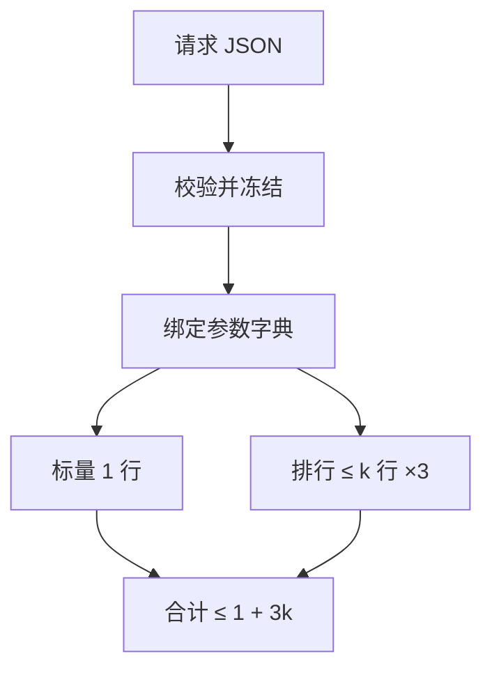

## Q
销售报表上线后出了三件事：筛选 `region=east` 时总数与排行榜对不上；有人在商品筛选里填 `x' OR '1'='1` 想看全部数据；还有一次请求拉回了成千上万行再在应用里算。怎样让查询一致地应用资格与筛选、安全地绑定请求值，并把返回行数压在 `32 + 3k` 以内？

## A
**资格与筛选写一次，值只绑定不拼接，聚合与限量都交给数据库。**

- **一份 WHERE 被四条查询复用**：筛选漏在某一条里，就是"总数与排行对不上"的来源
- **值走 `$name` 绑定**：`$item IS NULL OR itemName = $item` 让"不筛选"也走同一条语句；`x' OR '1'='1` 只是一个不匹配任何商品名的普通字符串
- **表名可拼，值不可拼**：`keyspace` 是受信任的带引号标识符；日期、状态、地区、商品、`k` 全部绑定，`LIMIT $k` 也是；连语句里的常量 `sale`、`active`、`termed` 也绑定，请求带来的 `"active"` 才不会在语句里出现字面量
- **聚合在库里做**：`COUNT(DISTINCT CASE WHEN … END)`、`SUM`、`GROUP BY`、`ORDER BY`、`LIMIT`；应用里只做字段映射
- **行数算得出来**：1 行标量 + 3 个至多 k 行的排行 = 至多 1 + 3k，永远小于 32 + 3k



```python
sql = 'SELECT COALESCE(SUM(itemQuantity), 0) AS n FROM "sales" WHERE ($item IS NULL OR itemName = $item)'
ctx.query(sql, {"item": "x' OR '1'='1"})   # [{'n': 0}]：整串当作商品名，一行也匹配不上
ctx.query(sql, {"item": None})             # 同一条语句，同一个占位符：不筛选
```

<details class="pt"><summary>延伸</summary>

流量涨十倍后瓶颈是四次扫表而不是行数：先加 `saleDate` 索引，再不够合成一条查询。处理函数不持有可变状态，多个线程或进程同时服务请求互不影响。

</details>

**知识点：** 边界校验（Validate at the Boundary）、规格与契约（Specifications）、先测量（Measure First）
