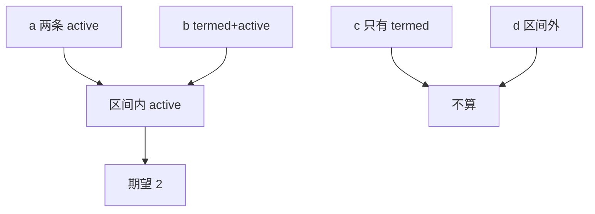

## Q
你要给销售报表加一条测试，专门拦住"同一个客户有好几条 active 销售，却被数了好几次"这类实现。数据怎么造？期望值怎么从记录里推出来？它能拒绝哪几种看似合理的错误实现？

## A
**造几个形状不同的客户，期望值手算，让数据库查询去对它。**

- **造数据**：a 两条 active；b 一条 termed 加一条 active；c 只有 termed；d 的 active 销售在区间之外
- **手算期望**：区间内有 active 销售的客户是 a 和 b，所以 `active_customers == 2`
- **拒绝 `COUNT(列)`**：按行数会得 3（a 被数了两次）
- **拒绝漏掉 active 条件**：`COUNT(DISTINCT customerId)` 会把 c 也算进去，得 3
- **拒绝漏掉日期区间**：d 的区间外销售被算进去，也得 3
- **同时钉住状态筛选**：再请求 `status=termed`，期望 `active_customers == 0`



```python
ctx = make([
    sale("a", "tea", 1, 1, "2026-01-02"), sale("a", "tea", 1, 1, "2026-01-03"),
    sale("b", "tea", 1, 1, "2026-01-04", status="termed"), sale("b", "tea", 1, 1, "2026-01-05"),
    sale("c", "tea", 1, 1, "2026-01-06", status="termed"),
    sale("d", "tea", 1, 1, "2025-12-31"),
])
assert call(ctx, WINDOW)[1]["active_customers"] == 2
assert call(ctx, {**WINDOW, "status": "termed"})[1]["active_customers"] == 0
```

<details class="pt"><summary>延伸</summary>

好测试是对着"错误实现"设计的：写完把实现改错（去掉 `DISTINCT`、去掉区间条件），确认它变红再还原。数据量大时再补一条行数预算的测试，用上下文记下每次查询返回的行数。

</details>

**知识点：** 用例选择（Partitioning & Boundaries）、验证输出（Verification）、pytest 的常用工具（pytest Toolkit）
