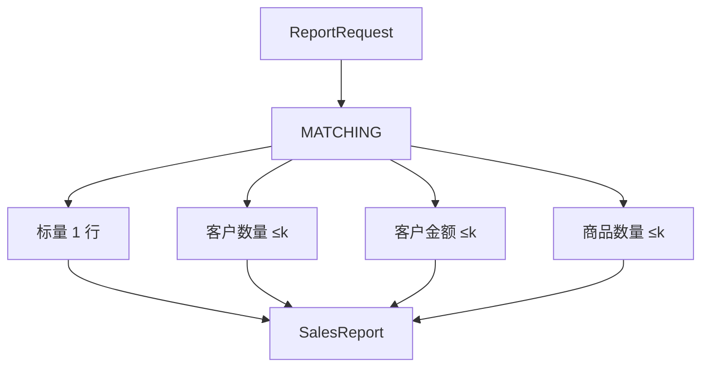

## Q
在销售报表服务里，你要存哪些状态？哪条不变量最要紧，由谁来守？

## A
**服务自己不存状态；最要紧的不变量是"六个数字看的是同一批行"。**

- **只读一张表**：`sales` 一行一次购买；没有汇总表，没有缓存，每次请求现算
- **一个 WHERE，四条查询共用**：资格与筛选写成常量 `MATCHING`，一条标量查询和三条排行查询都拼上它；少拼一处，总数就和排行对不上
- **请求是一份冻结的参数字典**：`ReportRequest` 校验后不可变，`bindings()` 给出同一份 `$name` 参数；值从不进 SQL 文本，只有表名与固定列名可以拼
- **行数由语句的形状保证**：标量查询聚合成 1 行，每个排行 `LIMIT $k`，合计 ≤ 1 + 3k，落在 32 + 3k 之内
- **平局顺序属于查询**：`ORDER BY 数值 DESC, 键 ASC`，不依赖插入顺序或默认排序



```python
def _leaders(self, request, key, measure):
    rows = self._rows(f"""
        SELECT {key} AS leader, SUM({measure}) AS total
        FROM {self._table} WHERE {MATCHING}
        GROUP BY {key} ORDER BY total DESC, {key} ASC LIMIT $k""", request)
    return tuple((row["leader"], row["total"]) for row in rows)
```

<details class="pt"><summary>延伸</summary>

四条查询各扫一遍表；嫌慢先给 `saleDate` 建索引缩小每次扫描，再不够合成一条带 CTE 的 `UNION ALL`（表只扫一次，行数仍是 1 + 3k）。表大到每次现算不可接受时，才引入按天预聚合的汇总表，同时要决定它和明细怎样保持一致。

</details>

**知识点：** 内存持久化（In-Memory Persistence）、不变量与封装（Invariants）、值对象与实体（Value vs Entity）
