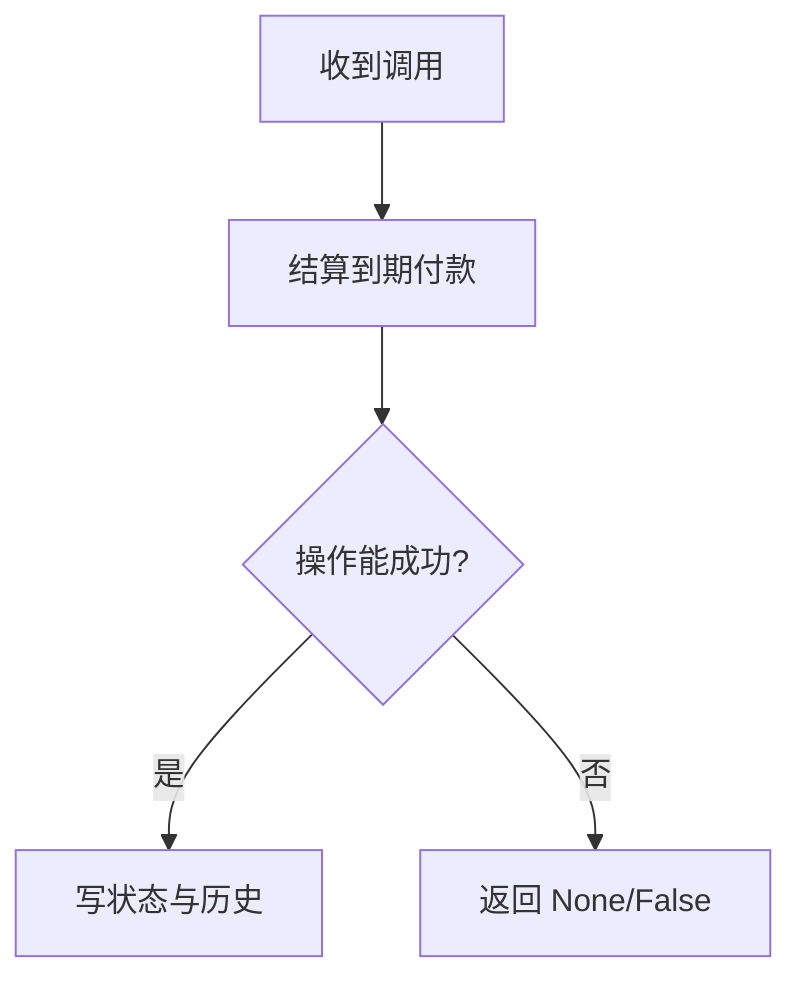

## Q
在带定时付款的银行账本里，调用方按严格递增的时间戳依次调用存款、转账、转账批次、安排与取消付款、合并账户、支出排名和历史余额查询，失败时要返回什么由合同规定。开工前你会先定下哪几条规则？

## A
**每次调用先结算到期付款，失败用返回值，批次整体提交，历史记在事件时刻**

- **每次调用先结算**：到期时间不晚于本次时间戳的付款先走，查询和会失败的调用也一样；到期那一刻再取消已经太晚
- **付款排队按（到期时间, 序号数值）**：payment10 排在 payment9 之后；钱不够就永久失败，不重试，同刻的存款救不了它
- **失败是返回值**：`None` / `False`，不抛异常；用过的账户 ID（含被并掉的）永不复用
- **批次全有或全无**：后一笔可以花前一笔刚收到的钱；失败只丢批内改动，已结算的付款保留
- **历史记在事件时刻**：付款记在到期时刻；合并后的总额从合并时刻起算，不追溯
- **排名**：累计转出降序、ID 的 Python 字符串顺序升序，含 0；只计成功转账与成功付款



```python
def settles(method):
    @wraps(method)
    def wrapper(self, timestamp, *args, **kwargs):
        self._settle(timestamp)               # 每个公开方法先结算
        return method(self, timestamp, *args, **kwargs)
    return wrapper

def _settle(self, now):
    while self._due and self._due[0][0] <= now:       # 到期 <= 本次时间戳
        due, _, pid = heapq.heappop(self._due)        # 堆序：(到期, 序号, 编号)
        p = self._pending.pop(pid, None)              # 已取消则取不到
        if p and p.owner.balance >= p.amount:         # 不够就永久失败，不留痕
            p.owner.balance -= p.amount
            p.owner.outgoing += p.amount
            p.owner.history.record(due, p.owner.balance)   # 记在到期时刻
```

<details class="pt"><summary>延伸</summary>装饰器让"入口先结算"成为结构而不是记性；换成数据库后，结算变成按（到期时间, 序号）排序的一条查询，规则不变。</details>

**知识点：** 任务调度器（Task Scheduler）、异常与错误值（Exceptions vs Values）、边界校验（Validate at the Boundary）
