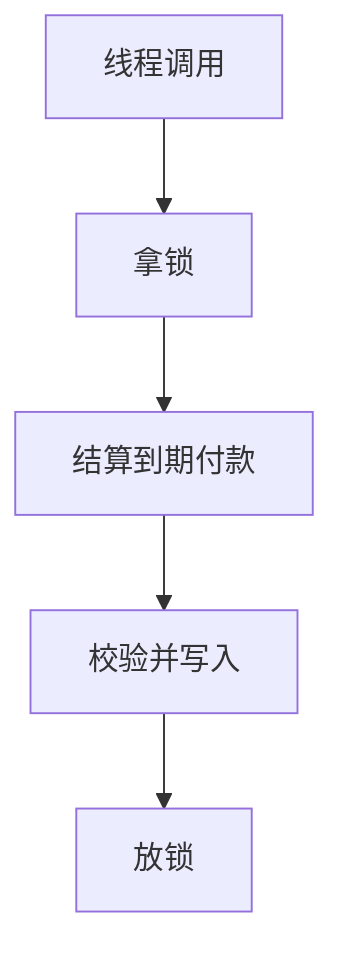

## Q
带定时付款的银行账本开始被多个线程同时调用：一个线程在转账批次，一个在取消付款，一个在合并两个账户。哪些步骤必须不可分割？只给每个方法里的字典各加一把锁够不够？流量大了锁成了瓶颈怎么办？

## A
**一把锁罩住"结算 + 校验 + 写入"整个公开方法，不是只罩字典**

- **结算与操作是一个整体**：先结算、再校验、再写入；锁只罩写入，另一个线程插在结算与校验之间，付款顺序就乱了
- **批次**：演算与提交在同一个临界区，否则演算时看到的余额，提交时已被别的线程改掉
- **合并**：余额、累计转出、待付款项换主人、退役 ID，四件事必须同时可见
- **取消对到期**：二选一，谁先拿到锁谁赢；"到期那一刻取消太晚"在并发下就是锁的顺序
- **只加字典锁不够**：每一步单独安全，组合起来仍会超支或丢付款
- **降低竞争**：按账户分片、每片一把锁；批次与合并跨账户，要按 ID 排序依次加锁，避免死锁



```python
def settles(method):
    @wraps(method)
    def wrapper(self, timestamp, *args, **kwargs):
        with self._lock:                          # RLock：内部方法可以互相调用
            self._settle(timestamp)               # 结算与操作在同一把锁下
            return method(self, timestamp, *args, **kwargs)
    return wrapper
```

<details class="pt"><summary>延伸</summary>CPython 的 GIL 只保证单条字节码不被撕开，"先检查后写入"仍会被切开；分片之后统计类查询（排名）要按固定顺序取全部分片锁。</details>

**知识点：** 复合操作（Compound Actions）、线程安全结构的写法（Thread-Safe Structures）、死锁及其亲戚
