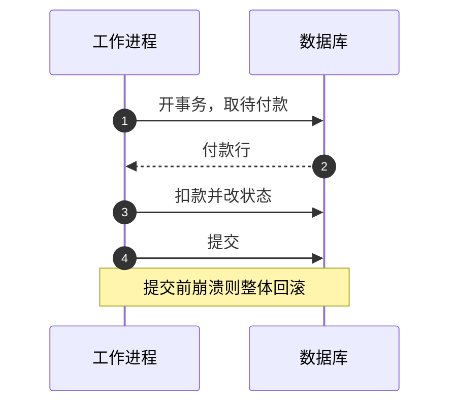

## Q
带定时付款的银行账本把付款放在进程内存里。某次付款刚扣完款，进程就被杀掉，重启后调度器又把同一笔付款跑了一遍。要让执行和重试都安全，你会怎么改？重启后"余额不足而永久失败"的那一笔又要怎么处理？

## A
**付款状态落库，扣款与改状态在同一事务里，付款编号做幂等键**

- **状态落库**：待付款项、到期时间、状态都存在库里，重启后从库里重建队列，不靠内存
- **同一事务**：扣款、写余额历史、把付款标成已付，要么全有要么全无
- **幂等键**：只处理 `state = 'pending'` 的行；同一编号再来一次，查不到待付款，什么都不做
- **失败也落库**：余额不足就写成"失败"，否则重启后会拿新余额重试，违背"永久失败"
- **多个工作进程**：按（到期时间, 序号）取一批并加行锁，同一笔只有一个工作进程能拿到
- **外部真实扣款**：不能回滚，拆成"已发出请求""已确认"两个状态，重放时带同一个幂等键



```python
def run_payment(conn, pid):
    with conn:                                     # 一个事务：扣款与标记同生共死
        row = conn.execute("SELECT owner, amount FROM payment WHERE id = ? AND state = ?",
                           (pid, "pending")).fetchone()
        if row is None:
            return                                 # 已处理过：重试什么也不做
        owner, amount = row
        paid = conn.execute("UPDATE account SET balance = balance - ? WHERE id = ? AND balance >= ?",
                            (amount, owner, amount)).rowcount
        conn.execute("UPDATE payment SET state = ? WHERE id = ?",
                     ("paid" if paid else "failed", pid))
```

<details class="pt"><summary>延伸</summary>同一笔付款重复执行两次，第二次查不到待付款，余额只扣一次；多进程用 `SELECT … FOR UPDATE SKIP LOCKED` 取行，避免互相等待。</details>

**知识点：** 重试与退避（Retry & Backoff）、持久化与恢复（Persistence & Resume）、非法转移与幂等（Illegal Transitions）
