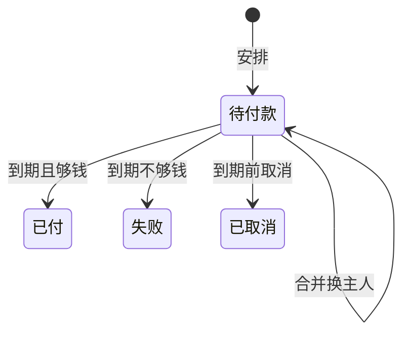

## Q
在带定时付款的银行账本里，要存哪些状态才能同时回答"现在的余额""最大的支出者""任意过去时刻的余额"，并让付款能取消、能随合并换主人？哪条不变量最要紧？账本跑得很久之后，历史查询为什么不会变慢？

## A
**每个账户一条余额时间线，待付款项一个堆加一个字典；时间线只前进**

- **账户**：余额、累计转出、一条 `BalanceHistory`（按时间升序的 (时间, 余额)）
- **待付款项**：按编号的字典负责取消与查找，`(到期, 序号, 编号)` 最小堆负责出队；取消只删字典，堆里的残留项到期时跳过
- **残留不堆积**：堆比待付款项多出一倍还多就重建，取消再多内存也有界
- **最要紧的不变量**：时间线只前进、同一时刻只留最后一个余额；任何写入之前，校验已经全部通过
- **历史查询**：`bisect_right` 找最近的、不晚于 `time_at` 的点，O(log n)；合并只追加一个点，旧点不动，所以不追溯
- **ID 集合**：`_ever_used` 含已并掉的账户，永不复用



```python
class BalanceHistory:
    def __init__(self):
        self._times, self._balances = [], []

    def record(self, time, balance):
        if self._times and self._times[-1] == time:
            self._balances[-1] = balance          # 同一时刻只留最后一个
        else:
            self._times.append(time)
            self._balances.append(balance)

    def at(self, time):
        i = bisect_right(self._times, time)       # 第一个晚于 time 的位置
        return self._balances[i - 1] if i else None   # 此前没有点：账户还不存在
```

<details class="pt"><summary>延伸</summary>存进数据库就是 (账户, 时间) 的有序索引，"最近的不晚于 t"是一次向下取整查询（`WHERE time <= ? ORDER BY time DESC LIMIT 1`）；很老的点可以按月归档，查询只翻一页。</details>

**知识点：** 不变量与封装（Invariants）、按访问模式选结构（Choosing Structures）、内存持久化（In-Memory Persistence）
