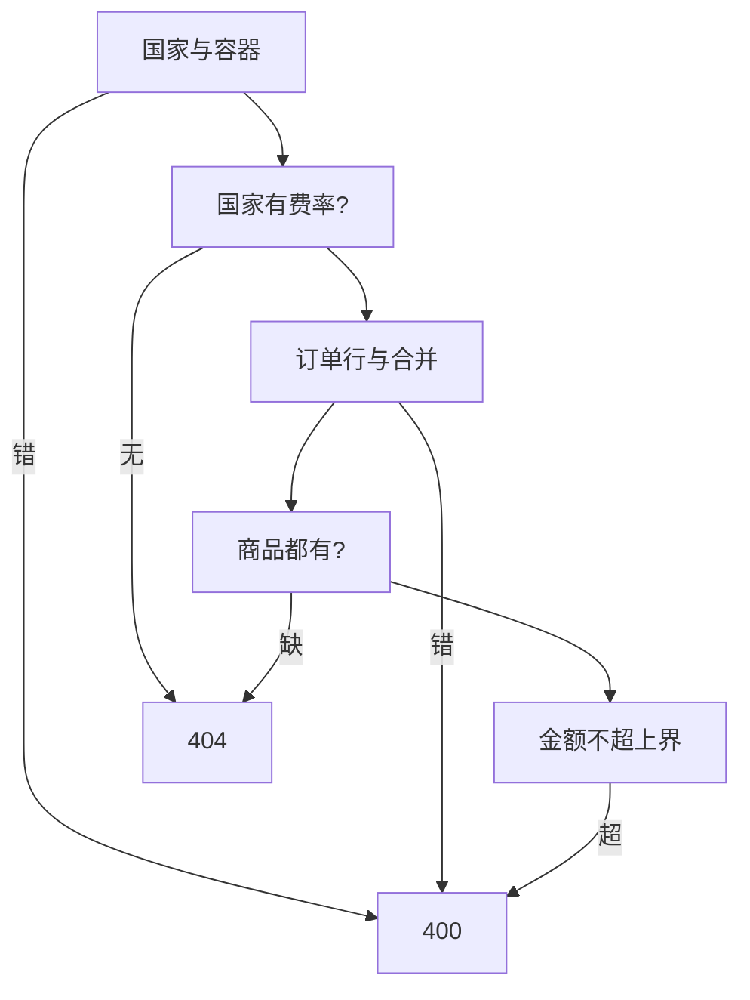

## Q
你要给电商写一个运费服务（ShippingService）：整批登记"国家加商品"的分段费率、按订单报价、列出现有费率。动手写之前，你会先定下哪几条规则，使隐藏测试没有可钻的空子？

## A
**语法先于分段，整批原子，合并后逐段累计，报价错误五层有序**

- **登记两个阶段**：所有行的语法先过一遍（400），再按（国家，商品）校验分段（422）；语法错在批次的任何位置，都先于分段错
- **分段表连续**：按最小数量排序，从 1 起首尾相接、每段最大不小于最小、恰好末段无上界；零锚点、缺口、重叠、起点重复、末段有限都是 422
- **整批原子、按对替换**：失败什么都不变，包括同批的其他国家；成功时批里出现的对整体替换，其余保留，201 返回输入行数
- **算价**：同一商品先合并数量；从第 1 件起每走到一段就加一笔，`incremental` 按进入件数，`fixed` 一次；数量 0 拒绝
- **输入严格**：不去空白、区分大小写、只认 ASCII 数字、前导零可以、每个数字 ≤ 1,000,000
- **错误五层**：国家和容器（400）→ 国家无费率（404，空订单也是）→ 订单行畸形或合并超限（400）→ 商品无费率（404）→ 费用超 2,147,483,647（400）



```python
def calculate_shipping(self, country, items):
    if not is_country(country) or not isinstance(items, (list, tuple)):
        raise _invalid()                                  # ① 400
    book = self._schedules.get(country)
    if book is None:
        raise ServiceError(404, "country_not_found")      # ② 空订单也一样
    quantities = {}
    for item in items:                                    # ③ 畸形行、合并后超限
        product, quantity = parse_item(item)
        quantities[product] = quantities.get(product, 0) + quantity
        if quantities[product] > MAX_TOKEN:
            raise _invalid()
    if any(product not in book for product in quantities):
        raise ServiceError(404, "product_not_found")      # ④
    # ⑤ 逐商品算 fee、累计 total，任何一个超过 MAX_CENTS 抛 400
```

<details class="pt"><summary>延伸</summary>规则越多越要把数字例子先变成测试；"最小是 0 算哪一层""商品名畸形算 400 还是 404"这类语义自己定，不交给编程智能体顺手选。</details>

**知识点：** 规格与契约（Specifications）、接口的错误契约（Error Contract）、边界校验（Validate at the Boundary）
