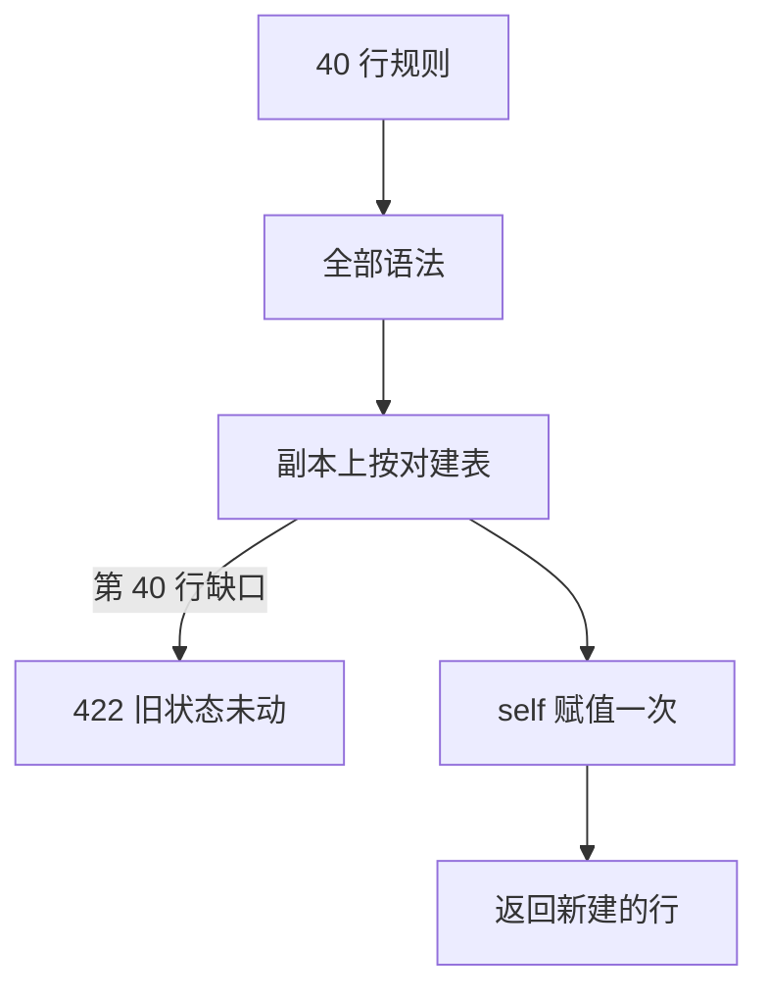

## Q
运费服务（ShippingService）收到一批 40 条规则，第 40 条让某个商品的分段出现缺口；调用方登记完把自己的规则列表清空，又把拿到的费率列表清空再用。你怎么保证旧费率原封不动、已返回的结果不受影响？用哪个测试守住它？

## A
**先验证整批再一次赋值，内部只存不可变值，返回时新建容器**

- **先验证整批**：40 行全部解析、按对建完分段表之后，才碰 `self._schedules`；第 40 行的缺口以 422 抛出时，前 39 行没有留下任何东西
- **失败保留旧状态**：建表改的是局部副本，抛错就丢；成功时只有一行赋值，没有回滚代码，也就没有回滚的缺陷
- **输入不被持有**：规则列表只被读取，解析出的是新值；调用方事后清空自己的列表，已登记的费率不变
- **内部只存不可变值**：`Tier`、`Schedule` 是冻结的，`tiers` 是元组；行字典和 `breakdown` 每次新建，调用方清空它们碰不到内部
- **回归测试**：同批里放一个合法的新商品加一个缺口的商品，断言 `list_rules()` 前后相等，且给新商品的国家报价仍是 `country_not_found`
- **和线程安全不是一回事**：两个线程各自复制、各自赋值，后者覆盖前者；要并发就用一把锁包住"复制、校验、赋值"



```python
def build(cls, tiers):
    ordered = sorted(tiers, key=lambda t: t.low)
    expected = 1                                  # 下一段必须从这里开始；None = 已无界
    for tier in ordered:
        if tier.low != expected or (tier.high is not None and tier.high < tier.low):
            raise ServiceError(422, "invalid_rules")
        expected = None if tier.high is None else tier.high + 1
    if expected is not None:                      # 末段有限
        raise ServiceError(422, "invalid_rules")
    return cls(tuple(ordered))                    # 冻结的元组
```

<details class="pt"><summary>延伸</summary>读者那一侧不需要锁：字典被整体换掉，报价先取一次 `self._schedules` 的引用，就读到一份一致的快照；多进程时靠数据库事务或"比较版本再写"。</details>

**知识点：** 防御性拷贝（Defensive Copying）、复合操作（Compound Actions）、不变量与封装（Invariants）
