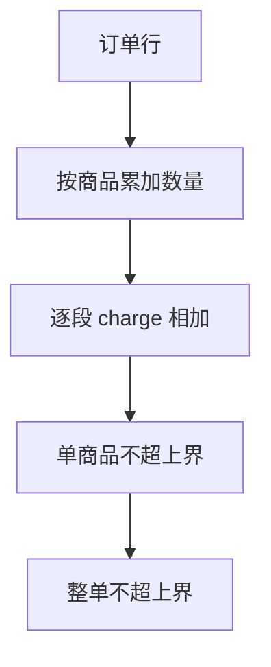

## Q
运费服务（ShippingService）里，水壶的分段是：第 1–4 件每件 300、第 5–9 件一笔固定 900、第 10 件起每件 150。订单有两行 `kettle,6` 和 `kettle,5`。为什么必须先合并再算价？订单有 L 行、P 种商品、每种至多 T 段，算价花多少时间和空间？流量大了怎么优化？

## A
**合并报 2400，分开报 4200：固定段只收一次**

- **不合并为什么错**：6 件收 `4*300 + 900 = 2100`，5 件也收 2100，固定段被收了两次，合计 4200；合并成 11 件是 `1200 + 900 + 2*150 = 2400`
- **合并**：一个字典累加数量，`O(L)` 时间、`O(P)` 空间；同时检查合并后 ≤ 1,000,000
- **算价**：每个商品对它的 `T` 段各调一次 `charge`，`O(P·T)`；结果按商品名排序 `O(P log P)`；整体 `O(L + P·T + P log P)` 时间、`O(P)` 额外空间
- **精确整数**：费用一个商品最大 10^12，Python 整数不溢出，算完再和 2,147,483,647 比：商品一次，整单一次
- **一个优化**：登记时预算"走满前 i 段的累计费用"，报价用 `bisect` 找 q 落进的段，每个商品从 `O(T)` 降到 `O(log T)`；段数只有几段时不值得
- **不信任规模**：批次行数、订单行数在适配器一层设上限



```python
def charge(self, quantity):
    if quantity < self.low:
        return 0                                   # 没走到这一段
    if self.kind is TierKind.FIXED:
        return self.cost                           # 进入就收一次
    top = quantity if self.high is None else min(quantity, self.high)
    return (top - self.low + 1) * self.cost        # 进入的件数 × 单价

def fee(self, quantity):                           # Schedule 上
    return sum(tier.charge(quantity) for tier in self.tiers)
```

<details class="pt"><summary>延伸</summary>费率持久化、多实例、费率会变时：每次成功登记得到递增版本号，每个版本一份不可变快照；报价开始读一次版本号，整张订单按这个版本算，响应带上版本号；登记用"比较版本再写"，冲突就重试。</details>

**知识点：** 时间与数字（Time & Numbers）、值对象与不可变性（Value Objects）、不变量与封装（Invariants）
