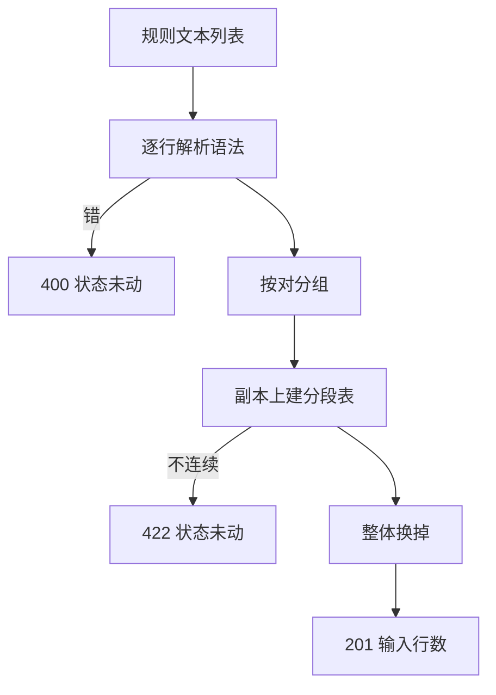

## Q
运费服务（ShippingService）要记住所有登记过的分段费率，并保证"整批要么全生效、要么全不生效"，每对（国家，商品）的分段表还必须从 1 起首尾相接。你会存哪些状态，哪条不变量最要紧，登记怎么写？

## A
**只存验证过的不可变分段表；登记在副本上改，一次赋值**

- **状态只有一份**：`{国家: {商品: Schedule}}`，存在服务实例上，不放在类或模块里，不同实例互不影响；"这个国家有没有费率"由字典直接回答，不另存集合
- **最要紧的不变量**：字典里的每张 `Schedule` 都从 1 起、首尾相接、末段无上界；它只能由 `Schedule.build` 构造，拿到一张就等于拿到一份证明
- **`Tier` 与 `Schedule` 冻结**：分段是冻结的数据类，分段表里是元组，登记之后没有任何代码能改它们
- **语法与分段分开**：`parse_rule` 只产出值，不碰服务；全部语法过了才开始建表，所以 400 先于 422
- **失败不用回滚**：建表改的是局部副本 `staged`，抛错时副本被丢掉；成功之后才 `self._schedules = staged`
- **替换按对**：`staged[国家][商品] = 新表`，旧分段整体丢掉，批里没出现的对原样保留



```python
def register_rules(self, rules):
    parsed = [parse_rule(line) for line in rules]       # 全部语法先过
    grouped = {}
    for country, product, tier in parsed:
        grouped.setdefault((country, product), []).append(tier)
    staged = {c: dict(p) for c, p in self._schedules.items()}   # 副本
    for (country, product), tiers in grouped.items():
        staged.setdefault(country, {})[product] = Schedule.build(tiers)  # 不连续则 422
    self._schedules = staged                             # 唯一的一次写入
    return 201, {"registered_count": len(parsed)}
```

<details class="pt"><summary>延伸</summary>换成数据库时，"解析、建表、赋值"变成一个事务（删旧行、插新行、校验连续性）；费率会变时，每次成功的登记生成一个版本，一次报价从头到尾读同一个版本。</details>

**知识点：** 不变量与封装（Invariants）、值对象与不可变性（Value Objects）、边界校验（Validate at the Boundary）
