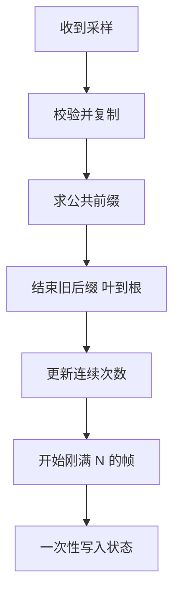

## Q
在流式调用栈处理器里，每个采样给出从最外层到最内层的栈，要把相邻采样的差别转成 start/end 事件，还要支持"连续 N 次才确认"、先校验再改状态、从快照续跑。开工前你会先定下哪几条规则？

## A
**帧按完整前缀识别，先结束后开始，连续 N 次才确认，先校验再提交**

- **帧 = 完整有序前缀**：递归的同名帧在不同深度是不同的帧；根变了，同名的叶子也要先结束再开始
- **一个采样内的顺序**：旧后缀从叶到根结束，新后缀从根到叶开始；事件用当前采样的时间戳，名字原样
- **确认**：同一完整前缀连续第 N 次才开始，不回填时间戳；保留的父帧保留次数，中断就清零；未确认的帧不产生结束事件
- **不补事件**：输入耗尽不补结束，两个采样之间没观察到的调用不去猜
- **先校验再提交**：时间戳是精确的 int 或 float、有限、非负、严格递增（按精确数值比较），名字是非空字符串；失败的调用不消耗时间戳
- **快照**：上一个栈加每层连续次数（封顶 N），从它继续输出逐字相同



```python
def feed(self, sample):
    ts, stack = check_sample(sample, self._last_ts)            # 先校验、复制
    n, old = self._n, self._streaks
    keep = shared_prefix(self._previous, stack)                # 保留的公共前缀
    active = sum(1 for count in old if count == n)             # 已确认的层数
    events = [Event("end", ts, self._previous[i]) for i in range(active - 1, keep - 1, -1)]
    streaks = [min(n, old[i] + 1) for i in range(keep)] + [1] * (len(stack) - keep)
    events += [Event("start", ts, stack[i]) for i in range(min(keep, active), len(stack)) if streaks[i] == n]
    self._last_ts, self._previous, self._streaks = ts, list(stack), streaks   # 最后一步才写
    return events
```

<details class="pt"><summary>延伸</summary>规则写成断言比写成代码更早发现分歧：同一个栈在 N=1 与 N=3 时的事件不同，先用几个小例子把"何时开始、何时结束"对齐，再写循环。</details>

**知识点：** 边界校验（Validate at the Boundary）、不变量与封装（Invariants）、持久化与恢复（Persistence & Resume）
